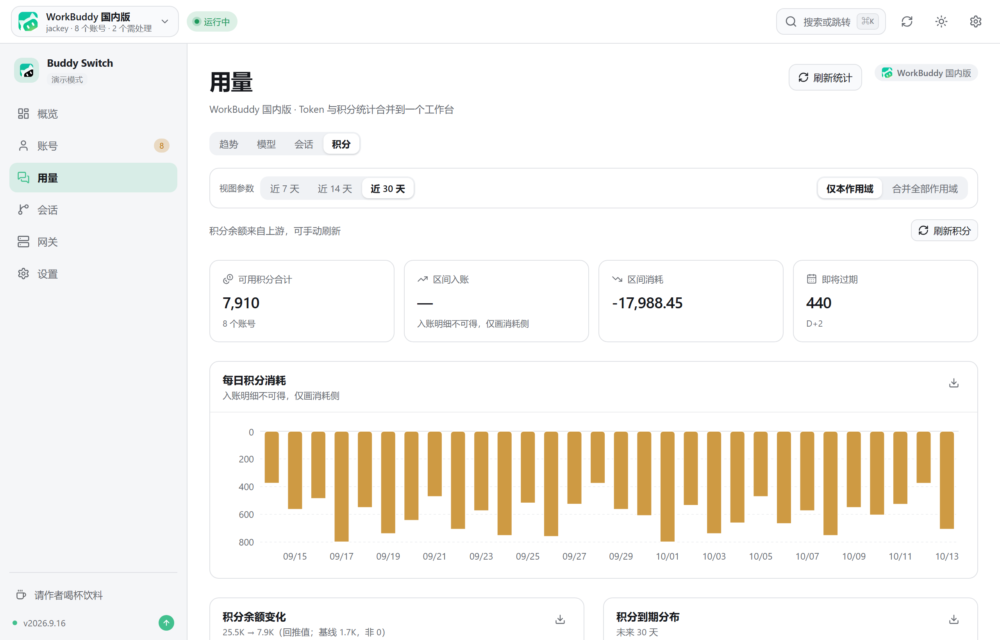
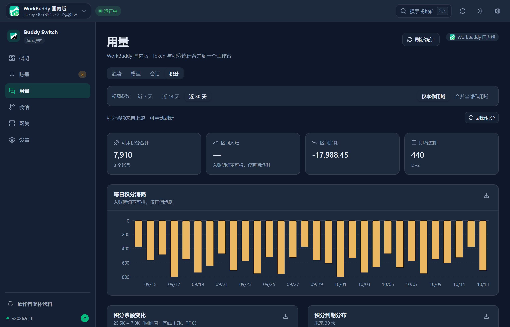
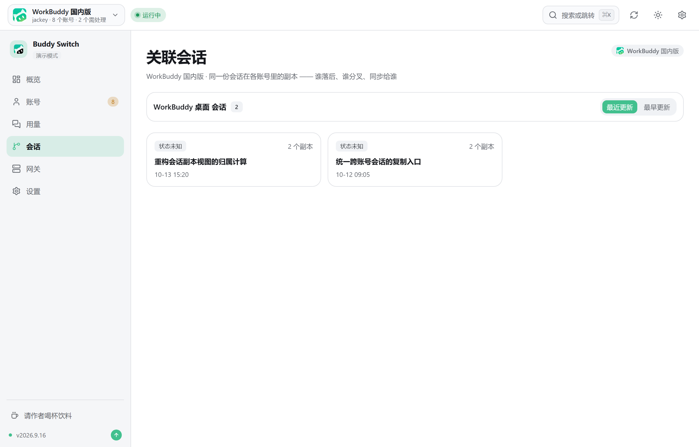
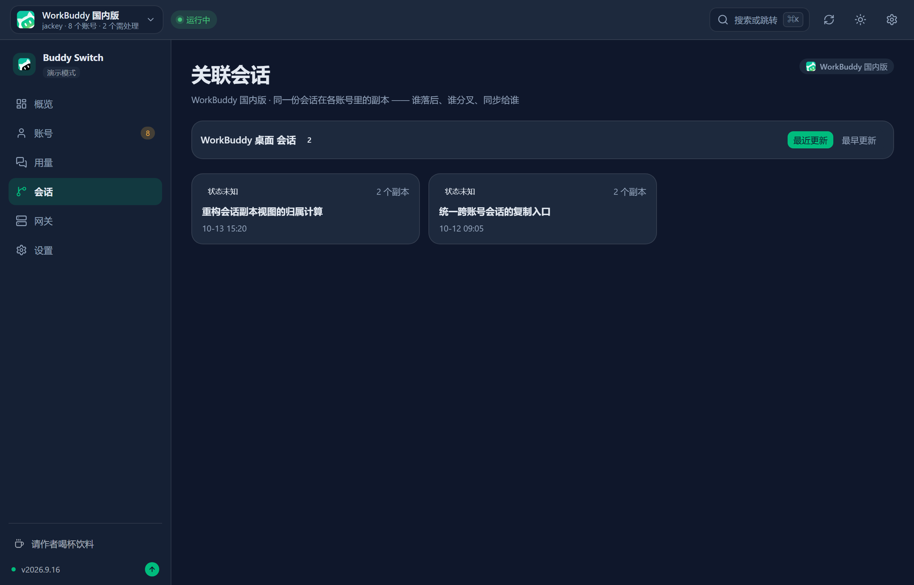
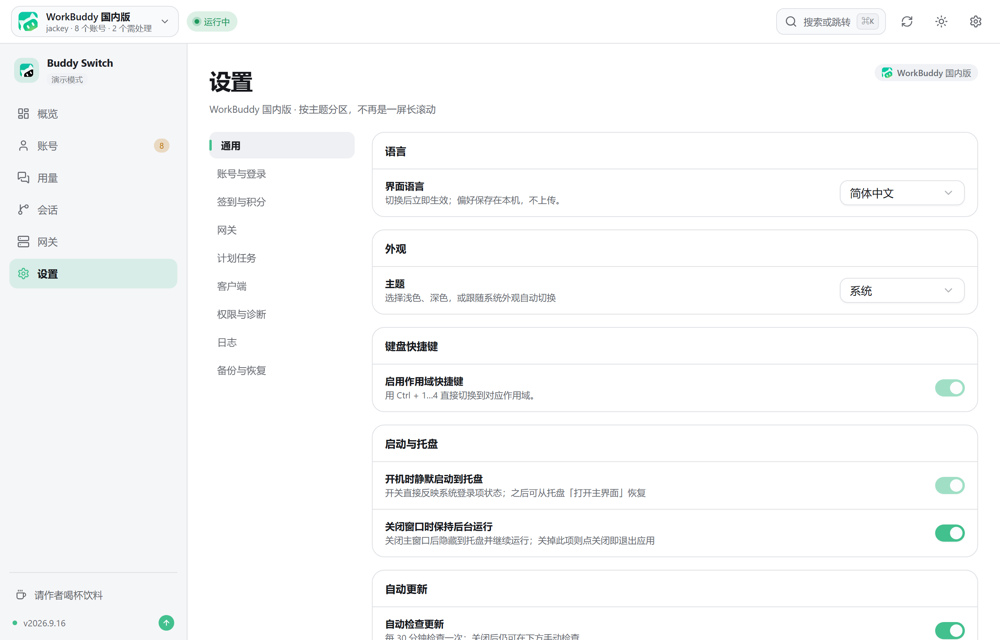
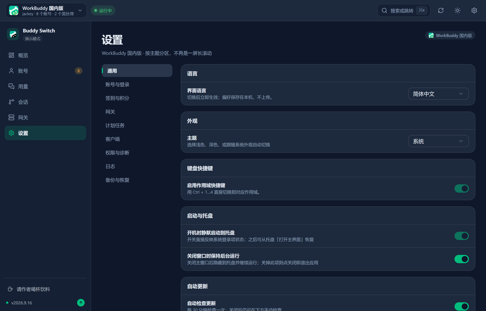
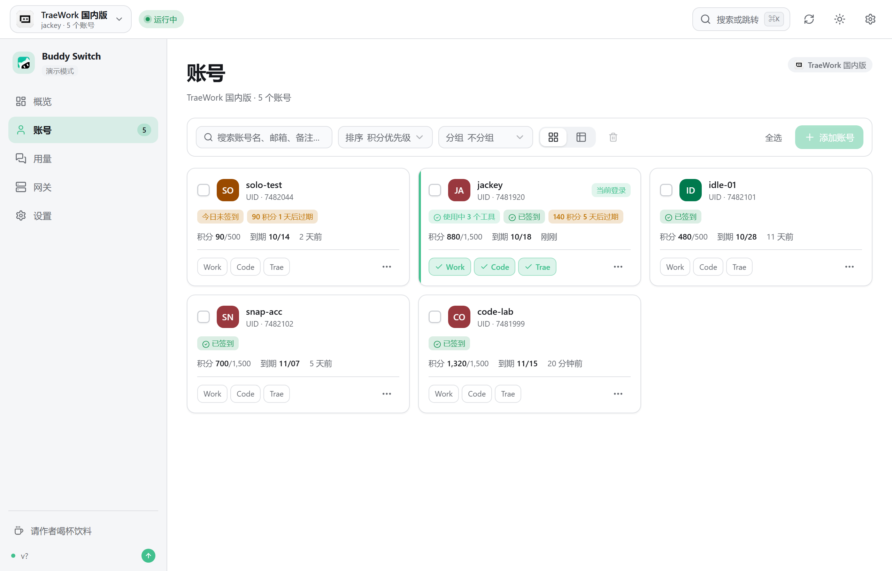
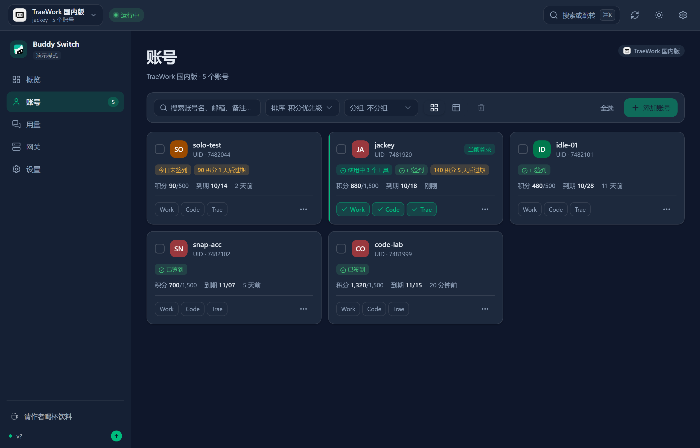
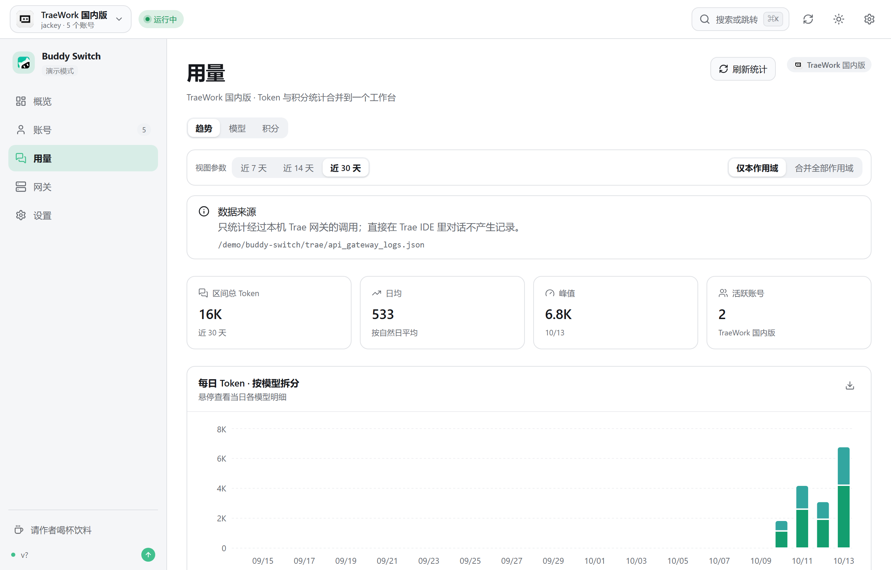
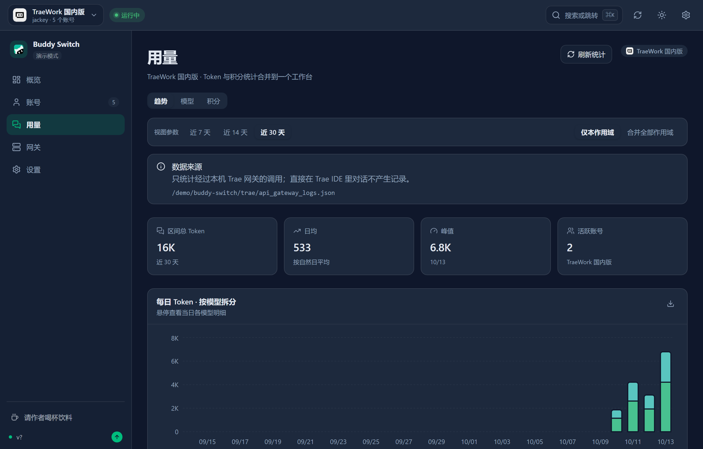

<p align="center">
  
</p>

<p align="center">
  <strong>Buddy Switch</strong><br />
  Account switcher for WorkBuddy / CodeBuddy / Trae
</p>

<p align="center">
  <a href="README.md">简体中文</a> · <strong>English</strong>
</p>

# Buddy Switch

**A multi-account manager for WorkBuddy / TraeWork**: an overview workbench that puts everything needing attention in front of you, OAuth sign-in with one-click login-state switching, check-in and credit-expiry tracking, token and credit usage merged into a single Usage workbench, cross-account linking of the same session's replicas with additive-safe syncing, a recycle bin for deleted accounts — and it can expose your model quota to other local tools through an OpenAI / Anthropic compatible endpoint.

> ⚠️ **Disclaimer**: this project is an **unofficial, third-party tool released under a noncommercial license** (source-available). It is not affiliated with, authorized by, sponsored by or endorsed by WorkBuddy, CodeBuddy, Trae / TraeWork or their respective rights holders. It reads and writes authentication data of third-party clients on your machine, sends automated requests on the schedule you configure, and can forward your model quota to other tools through a local endpoint. Before using it, read the [Disclaimer](docs/DISCLAIMER.en.md) in full, assess the risks yourself and make sure your usage complies with the applicable terms of service.

One interface, three forms:

| Form | How to get it | Notes |
| --- | --- | --- |
| **Desktop app** | Download the installer from [GitHub Releases](https://github.com/NextAgentX/trae-workbuddy-switch/releases/latest) | Packaged with Tauri; recommended for daily use |
| **webui (browser)** | Build from source, see [webui form](#webui-form-build-from-source) | The same frontend bundle as the desktop app, served over a local HTTP channel |
| **Online demo** | [GitHub Pages](https://nextagentx.github.io/trae-workbuddy-switch/) | Read-only demo; accounts, credits and request records are fictional data and all business actions are disabled |

> "**Overview**" is the default destination: first see whether any account needs a new sign-in, whether any credits are about to expire and whether today's check-in is done — then decide which page to visit.
>
> **No npm distribution yet**: the npm package `@nextagentx/buddy-switch` has not been published, so `npm i -g …` will not install it yet. For the webui form, follow [Build from source](#webui-form-build-from-source) below; the install command will be added here once it is published.

## Scopes: platform × region

The **scope selector** at the top-left decides "which set of accounts you are managing right now". A scope is platform × region — four in total:

| Scope | Clients managed | Region |
| --- | --- | --- |
| **WorkBuddy CN** | WorkBuddy desktop client, CodeBuddy CN IDE, CodeBuddy CLI, the CodeBuddy extensions for VS Code / JetBrains | CN |
| **WorkBuddy Global** | Same as above (global clients) | Global (WorkBuddy AI) |
| **TraeWork CN** | Trae Work (client `TRAE SOLO CN`), Trae IDE (`Trae CN`) | CN |
| **TraeWork Global** | Trae Work (`TRAE SOLO`), Trae IDE (`Trae`) | Global |

The four scopes are **fully independent**: separate account stores, separate clients, separate configuration. Switching one makes the sidebar, the content area and every statistic follow; the scope lives in the URL (`/s/wb-cn/accounts`), so **refreshing, sharing links and going back/forward all keep your current position**. `⌘K` / `Ctrl+K` opens the command palette for cross-scope search and navigation, and `⌘1`–`⌘4` switches scopes directly.

The sidebar has a fixed set of **6 destinations, identical item for item across both platforms**: **Overview · Accounts · Usage · Sessions · Gateway · Settings**.

> **The Trae side does not render the "Sessions" entry**: session cloning depends on that platform's own session storage and cloud-ownership mechanism, which only WorkBuddy has. This is **capability gating**, not a platform branch — hitting the URL directly gives a structured "not supported" empty state, never a list of WorkBuddy sessions.
>
> **Trae's program slots live on the account cards**: Trae Work and Trae IDE can coexist on one machine, and they are switched **inside** the Trae scope (the program-slot buttons on an account card) without occupying the sidebar. A program slot is a data dimension; the region is what makes up a scope.

## Quick start

### Desktop app

Download the installer for your platform from [GitHub Releases](https://github.com/NextAgentX/trae-workbuddy-switch/releases/latest):

| Platform | Installer | Installation |
| --- | --- | --- |
| macOS Apple Silicon (M-series, arm64) | `BuddySwitch_<version>_aarch64.dmg` | Open the DMG and drag `BuddySwitch.app` into Applications |
| macOS Intel (x86_64) | `BuddySwitch_<version>_x86_64.dmg` | Open the DMG and drag `BuddySwitch.app` into Applications |
| Windows x64 | `BuddySwitch_<version>_x64-setup.exe` | Run the installer and follow the prompts |
| Linux x64 | `BuddySwitch_<version>_amd64.deb` / `BuddySwitch_<version>_amd64.AppImage` | Install the `.deb` on Debian/Ubuntu; on other distributions mark the AppImage executable and run it directly |

On macOS, if the first launch reports that the developer cannot be verified, Control-click the app in Finder and choose **Open**, or go to **System Settings → Privacy & Security** and choose **Open Anyway**. Only when the installer came from the official Releases above and the system still reports it as damaged, run:

```bash
xattr -rd com.apple.quarantine "/Applications/BuddySwitch.app"
```

If the app starts but reports a permission error when switching accounts, see [macOS permissions](#macos-permissions) below.

### webui form (build from source)

This project is not distributed through npm yet, so the webui form has to be compiled locally. **Mind the order**: the frontend bundle is embedded into the server binary at **compile time** (`rust-embed`), so you must build the frontend first and the server second:

```bash
npm install
npm run build                                    # 1) build the frontend → dist/
cargo build --release -p buddy-switch-server     # 2) build the server (embeds dist/)
./target/release/buddy-switch                    # 3) start the local service + open the browser (buddy-switch.exe on Windows)
```

Subcommands available after building:

```bash
buddy-switch              # start the local service and open the browser
buddy-switch serve        # start the service only, without opening a browser (--port to set the port)
buddy-switch status       # print the current account in the terminal
buddy-switch version      # print the version
```

The webui listens on `127.0.0.1:57890` by default. The interface is identical to the desktop app — the same frontend bundle, with the desktop app going through the Tauri command channel and the webui through a local HTTP channel.

> If you change the frontend without rebuilding the server, the UI will not change (the embedded bundle is stale). Stop any running `buddy-switch` before rebuilding, otherwise linking fails on Windows because the binary is locked.

## Features

Six destinations in the sidebar, identical item for item across both platforms.

### Overview (one page, both platforms)

| Module | Description |
| --- | --- |
| Needs-attention list | Lays out everything to handle in the current scope: an account needs to sign in again / credentials expired / not checked in today / credits about to expire / client not running / no accounts yet. Every row carries an **inline action**, and "not checked in today" can be filled in with one click |
| Stat tiles | Total accounts, client tokens (today), credits consumed today, gateway requests (today); the "vs yesterday" comparison is **really computed** and no percentage is invented when yesterday has no data |
| 14-day token usage | A daily bar chart sourced from the same data as the tiles |
| Other scopes | Sign-in state and account counts for all four scopes at a glance, so you can see which one has work pending without switching |
| Capabilities | Rendered from the platform's capability list (check-in / Cat Travel / credit stats / OAuth / API gateway / auto-rotation / session cloning) |

### Accounts (WorkBuddy)

| Module | Description |
| --- | --- |
| Account management | OAuth QR-code sign-in, import from this machine, import from a backup file, add a token manually, delete accounts, export account backups |
| Card / table views | Two densities over the same data, plus search, sorting, group filtering, a batch bar and a detail drawer that opens from the whole card |
| Program slots | Five switchable slots on every card: WorkBuddy desktop (`WB`), CodeBuddy CN IDE (`IDE`), CodeBuddy CLI (`CLI`), VS Code CodeBuddy extension (`VSC`), JetBrains CodeBuddy plugin (`JB`) — plus one **read-only probe slot** (VS Code CodeBuddy plugin) that observes without switching |
| Account switching | Back up the auth file → close the client → write the target account → restart, with live progress feedback throughout |
| Session cloning | Copy the sessions selected on the current account to the target account under new ids (jsonl content + `workbuddy.db` index + edge-sync registration) |
| Automatic check-in | Enabled by default; checks on startup and catches up on a schedule; supports check-in all and a check-in log |
| Automatic travel | Automatically dispatches and claims the "Cat Travel" task |
| Token keep-alive | Lazy refresh (refresh only when the remaining lifetime is below a threshold before an operation) plus a daily keep-alive (one unconditional refresh per day by default), preventing refresh-token expiry |
| Automatic rotation | A background job periodically sets the account used by **subsequent** CodeBuddy CLI launches to the one with the most urgent credit expiry; the current session keeps its own account (policy below) |
| Migrate data on switch | Merge the current account's long-term memory and connector configuration into the target account (same-name entries merged recursively, deduplicated by content), with same-version and cross-version migration supported; the original content is backed up before being rewritten |
| Recycle bin | Deleted accounts go to the recycle bin and are **kept for 30 days**, restorable at any time; you can also purge one account or empty the bin (a purge deletes its credentials and snapshots too) |
| Permission check | macOS authorization walkthrough (App Management / Full Disk Access drag-to-authorize plus automatic detection) |
| Client rate-limit ledger | **Read-only** aggregation from the client's local data of "account × model × reset time": which account is rate-limited on which model and when it recovers; still-limited entries float to the top and are highlighted, recovered ones are dimmed. No gateway dependency, no account-state changes; queue-class codes (`6020` / `6022`) are shown as the raw code labelled "Queued" |

### Accounts (TraeWork)

| Module | Description |
| --- | --- |
| Account management | OAuth web sign-in (browser callback), paste `Cloud-IDE-JWT` manually, import from this machine, import from a backup file, delete accounts, export account backups |
| Program slots and groups | Switch the program slot on an account card (TraeWork / TraeCode / Trae; the scope's region decides the concrete client variant); accounts can be grouped and the list filtered by group |
| Check-in | One-click check-in with credit refresh; supports "skip accounts already checked in today" and automatic renewal; account cards show check-in status and cooldown |
| Credits | Per-account remaining credits, per-package breakdown and expiry times |
| Login-state switching | Write the selected account into the Trae client's login state (`profiles/`), with an automatic backup before switching; takes effect after restarting the client |
| Login-state snapshots | Save / restore / delete client login-state snapshots for easy rollback |
| JWT refresh | Refresh an account's JWT manually and see the remaining validity period (highlighted when close to expiry); it can also **renew on a schedule** (the `trae_jwt_refresh` task below), so it no longer depends on clicking refresh |
| Device identifier | View and reset the device identifier |
| Environment detection | Automatically detect the installed product lines, client versions, running state and userData directories |
| Runtime logs | Client data directories, gateway request logs and operation logs viewed in one place |

### Usage (one workbench, both platforms)

Four top-level views: **Trend · Models · Sessions · Credits**. Trae has no session-cloning capability, so it **does not render "Sessions"** and keeps only Trend / Models / Credits — a missing data source means no empty shell (an empty tab reads as "the data is zero"). There is exactly one parameter bar for the whole page — range (7 / 14 / 30 days) and data source (this scope only / all scopes merged) — and **switching sub-views does not reset it**.

| View | Description |
| --- | --- |
| Trend | Stat tiles (total tokens / daily average / peak / model count) + a daily stacked bar chart split by model + cumulative consumption curve + model share donut + activity heatmap |
| Models | Model share and model ranking, with mini trend lines from the same source as Trend |
| Sessions | Session ranking and session scatter — locate "the most expensive conversation" by tokens and call count |
| Credits | Aggregates official WorkBuddy request usage: daily trends, model breakdown, per-account consumption and request details; when official data is unavailable it clearly falls back to observing local balance snapshots. Includes credit-balance change and credit-expiry distribution |

> The two platforms **share the same chart set**: Trae's usage data is mapped into the common shape by an adapter and then reuses the same chart components, with identical block order and semantics — the resemblance is not a coincidence.

### Sessions (WorkBuddy only)

"Linked sessions" puts **the replicas of one session across accounts** on a single screen: who is behind, who diverged, and who to sync to.

| Capability | Description |
| --- | --- |
| Replica ownership | Lists "N replicas" per session group and which account each belongs to; when the source account was deleted it shows `uid (unknown account)` instead of hiding the row |
| Content-level state | **In sync / behind / diverged / unknown** is derived from the **content fingerprint** of the session jsonl (**not** from "whose timestamp is newer"), together with "common base N entries" and "+N since last in sync" |
| Safe sync | **Additive** semantics: only the source's new content is **appended** to the target; nothing already in the target is deleted or overwritten (stated permanently on the page) |
| Resolving divergence | Divergence cannot be merged automatically, so you must first choose which replica to keep; the others are overwritten by it (it is backed up first, and the number of discarded entries is stated) |
| Plugin session cloning | Copy historical sessions from the VS Code plugin / CodeBuddy IDE into other accounts of this scope. That is **not the same storage** as the desktop client, so "client not detected" and "this account has no sessions" are phrased as two different things |

### Gateway (independent per scope, plus a cross-scope unified entry)

Expose the current account's model quota to other local AI tools (Cursor, Claude Code, OpenWebUI, …) through **compatible endpoints**. Keys and account pools are isolated per scope. The page has **seven sections**: **Overview · Keys · Models · Account pool · Request proxy · Request log · Unified entry** (Trae has no "Request proxy", so it renders six).

| Capability | Description |
| --- | --- |
| Compatible protocols | OpenAI-compatible (`/v1/models`, `/v1/chat/completions`, `/v1/responses`) and Anthropic-compatible (`/v1/messages`), both supporting SSE streaming |
| Listen configuration | Binds to `127.0.0.1` only by default; changing it to `0.0.0.0` requires an explicit second risk confirmation |
| Default ports | WorkBuddy gateway `57891`; Trae gateway `7864`; **unified entry `57892`** (**off** by default — enable it manually under the "Unified entry" section). Trae also has a local MITM proxy port `8899`, which login-state capture depends on |
| API keys | Multiple keys can be created, each belonging to a specific region; the list shows only the prefix and **never stores plaintext or echoes the hash**. **Three actions**: revoke (sets `revoked_at`) · **restore** (clears `revoked_at`) · delete (**only revoked keys can be deleted**). A revoked row must offer **both** "restore" and "delete" — leaving only "delete" forces users to "delete and recreate, then update every client" |
| Model catalog | Fetch and display the available model list, refresh it manually, and **disable** individual models |
| Account policy | Configure the account-selection strategy and the account-pool balance refresh interval; the pool can verify upstream credential validity |
| Request proxy | Configure the gateway's outbound proxy |
| Request log | Record the model, account, tokens and status of every request; can be cleared |
| Integration guide | Ready-made configuration snippets for common tools, copyable in one click |
| Unified entry | The **third entry point, cross-scope**: merges both product lines' models into **one provider**, with the model id carrying its own source prefix (a namespace). Solves "the same model name overwrites itself across platforms/versions". See below |

#### Unified entry (the third product line, cross-scope)

The two existing gateways expose model ids that **carry no source** — the same `deepseek-v4.1-flash` is four different upstreams with different rates in WB CN / WB Global / Trae CN / Trae Global, while clients deduplicate by id, so only one entry can survive and they overwrite each other. The unified entry makes **the id carry its source**: model names are written as `<namespace>:<model-id>`.

| Capability | Description |
| --- | --- |
| One provider for every platform | A single port `57892`, a single key store (prefix `sk-uni-`), a single `/v1/models`. Clients only need one Base URL |
| Namespace = `{client-name}-{region}` | Four enabled by default: `wb-cn` · `wb-global` · `trae-cn` · `trae-global`; four more are **optional** (`traework-*` / `traecode-*`, the two legacy program lines), off by default and one click away |
| Bare model names are always rejected | A request without a prefix returns 400 plus the list of usable prefixes — no "guess a default namespace" fallback, which would silently pick the wrong pool when the table changes |
| One key can span platforms | A single key may authorize `wb-*` and `trae-*` at once; the namespace for business forwarding (`/biz/*path`) comes from the key's own field (business requests have no model name, so that is the only place it can come from) |
| The three entry points are independent | 57891 / 7864 / 57892 each listen separately; turning off the unified entry affects no existing client. `/v1/responses` is not supported on the Trae side at all, and the unified entry returns **501** for it (it does not silently downgrade to chat) |
| Cross-scope | Same nature as "the key table / request log are not version-filtered": **the scope selector above has no effect on the "Unified entry" section**, and card 1 says so explicitly |

> The unified entry's namespaces are **derived from the scope registry**: adding a platform or region makes its namespace appear automatically, with zero UI changes. For architecture and decisions see [`docs/redesign/UNIFIED-GATEWAY-ARCH.md`](docs/redesign/UNIFIED-GATEWAY-ARCH.md); for the interaction spec see [`docs/redesign/UNIFIED-GATEWAY-UI.md`](docs/redesign/UNIFIED-GATEWAY-UI.md); for client configuration see [`docs/GATEWAY-CLIENT-INTEGRATION.md`](docs/GATEWAY-CLIENT-INTEGRATION.md).
>
> ⚠️ Namespace parsing is **whole-string exact matching only, never prefix matching**: `trae` / `traework` / `traecode` are mutual prefixes, so any `starts_with`-style inference would send a request to a different account pool.

### Settings (one nine-item sub-navigation, both platforms)

**General · Account & sign-in · Check-in & credits · Gateway · Scheduled tasks · Client · Permissions & diagnostics · Logs · Backup & restore**. The section is carried by the URL (`?section=`), so it is no longer one long scroll. Scheduled tasks are split into two platform groups, **8 kinds in total**: six on the WorkBuddy side — check-in, Cat Travel, Activity Map, token keep-alive, Back-to-School and Night Owl; two on the Trae side — `trae_checkin` (check-in) and `trae_jwt_refresh` (automatic JWT renewal). Each has its own toggle and configurable execution hour.

### App-level capabilities (shared by all four scopes)

The sidebar footer and the app settings **do not follow the scope**; all four scopes share the same implementation.

| Capability | Description |
| --- | --- |
| App settings (⚙ in the top bar) | A right-hand drawer, not a dropdown: theme (light / dark / follow system), interface language (简体中文 / English), silent launch to tray at login, keep running in the background when the window is closed, auto-update (including an update proxy address), plus a "More" section |
| Global backup & restore | Covers **all scopes at once**: pick any of accounts / config / gateway, and credentials are **excluded by default** (ticking the credentials box asks for a second confirmation and warns about plaintext risk); the import can be previewed before applying |
| Skill manager | Scan the frontmatter of `{data_dir}/skills/<dir>/SKILL.md`, list them and **enable / disable** each entry (writing both `user-invocable` and `disable-model-invocation` together; **line-level rewrite**, every other byte preserved, including CRLF/BOM); supports cross-region (CN ↔ Global) copying to fill gaps (target side wins on conflict) and importing from a local directory / zip |
| Client settings hosting | Read and write the **proxied upstream clients'** own `settings.json` (both WorkBuddy versions plus Trae's four program slots): a declarative 6-slot spec table, a format fingerprint (indent unit + line endings), a **surgical byte-level patch** (minimal diff), backup / restore and cross-slot diffing; a process-running guard protects writes |
| Session floating window (desktop only) | A separate small window showing the state of sessions / tasks across sources (running / awaiting confirmation / done / failed); read-only, click to focus back on the original session. The sidebar toggle and the tray item are two faces of the same switch. Not rendered in the webui form. Its data comes from this tool's own switching progress plus **client sessions whose listening has been enabled** (next row) |
| Client session listening (**off by default**) | Once enabled under "Settings → Client", a hook is installed into the WorkBuddy (CN / Global) `settings.json` so tasks started inside the client stream their state into the floating window in real time. It requires an **explicit opt-in** and can be turned off and reverted at any time; install and uninstall both go through client-settings hosting (backup before writing, format preserved, **writes refused while the client is running**) and never overwrite the user's other hooks |

> ⚠️ "Client settings hosting" edits the **upstream clients' own** `settings.json`, which is a **different file** from this tool's own proxy settings (`proxy*` / `traePath*` on the `SettingsPage` / `TraeSettingsPage`, stored under `~/.buddy-switch/**`) — the names are merely similar.

## Usage

### General

1. **Pick a scope**: switch platform × region at the top-left; the sidebar follows, so choosing `TraeWork` takes you into Trae
2. **Check Overview**: the app lands on Overview by default — handle the rows under "needs attention" first (sign in again, not checked in today, credits about to expire)
3. **Search and jump**: `⌘K` / `Ctrl+K` opens the command palette for cross-scope search over accounts, pages and actions; `⌘1`–`⌘4` switches scopes directly
4. **App settings**: the ⚙ in the top bar opens the right-hand drawer for theme, interface language, silent launch at login and update options

### WorkBuddy

1. **Add an account**: Accounts page → "Add via OAuth QR" (device flow), "Import local account" or "Import backup"
   - Since client 5.6, the login-state tokens are stored encrypted. **"Import local account" automatically calls the local client to unwrap that encryption** (requires the WorkBuddy desktop app to be installed), so check-in / credits / usage stats work right after importing. If the client is missing or has changed its encryption scheme, the account is **still imported** but can only be used for "Switch"; click "Refresh token" on the account to retry unwrapping
2. **Switch accounts**: account card → "Switch"; you can optionally copy the current account's sessions along and merge long-term memory and connector configuration into the target account (for cross-version migration you can choose the data source region)
3. **Switch program slots**: the `WB` / `IDE` / `CLI` / `VSC` / `JB` buttons on each card choose which client the account is written into. "Switch CodeBuddy" only updates the default account used by **sessions loaded afterwards**; the currently running session is not switched — reload the session from ACP, or restart CodeBuddy CLI for it to take effect
4. **Automatic check-in / Cat Travel**: toggle them directly at the top of the Accounts page; Settings → "Check-in & credits" lets you tune parameters, run a check-in immediately and view logs
5. **Automatic rotation**: Settings → "Check-in & credits" → CodeBuddy CLI auto-rotation (policy below)
6. **View usage**: sidebar → "Usage" — the Trend / Models / Sessions / Credits views share one parameter bar; only "Refresh statistics" collects again
7. **Delete and restore**: deleted accounts go to the recycle bin (Accounts toolbar → "Recycle bin") and can be restored within 30 days
8. **Backup and migration**: Settings → "Backup & restore" handles export / import in one place, with credentials excluded by default

### TraeWork

1. **Add an account**: Accounts page → "OAuth web sign-in" (the browser completes authorization and then calls back) or "Paste JWT"; you can also use "Import local account" / "Import backup"
2. **Pick a program slot**: the program-slot buttons on an account card decide which client is operated (TraeWork / TraeCode / Trae); the region is already fixed by the scope in the top bar
3. **Check-in**: "Check in and refresh credits" on the Accounts page, or per account; enable "Skip already checked in" to avoid duplicate requests
4. **Switch login state**: account card → "Switch", which writes the selected client's login state and restarts the client; a snapshot is saved automatically before switching
5. **Snapshot rollback**: Settings → "Account & sign-in" holds the login-state snapshots for save / restore / delete
6. **View usage**: sidebar → "Usage" — Trend / Models / Credits (Trae has no session-cloning capability, so the "Sessions" view is not rendered)
7. **Gateway**: sidebar → "Gateway"; create a key and follow the integration guide on the page to configure it in your tool. To use **one provider across every platform** (model names carrying a namespace prefix), enable the "Unified entry" section on the gateway page (off by default, port `57892`)

### App-level capabilities (shared by all four scopes)

Available from the ⚙ "App settings" drawer regardless of scope:

1. **Skill manager**: drawer → "More" → Skill manager → pick a region to list entries under that region's `skills/` directory; **enable / disable** each entry with its switch (both frontmatter fields are written together), use "Copy from the other region" to fill gaps, or import from a local directory / zip
2. **Client settings hosting**: drawer → "More" → Client settings → pick the client slot to host (both WorkBuddy versions plus Trae's four program slots), then read and edit the target keys of its `settings.json`; writes are a **minimal byte-level patch** (indentation and line endings preserved), and you can inspect cross-slot diffs or back up / restore at any time. **Exit the corresponding client process before writing** (a running process is rejected outright)

### Automatic rotation policy (WorkBuddy)

The goal of automatic rotation is to avoid wasting credits by letting them expire: a background job periodically checks every account's credit expiry and sets the CodeBuddy CLI's default account for subsequent sessions to the **most urgent** one (earliest expiry that still has credits remaining). Neither the `apiKeyHelper` on macOS/Linux nor the settings env on Windows replaces the token a running session already holds; the rotation takes effect after ACP reloads the session or the CLI restarts. To avoid the default account changing too often, every check decides in this order:

1. **Eligible accounts**: only accounts that queried successfully, are not expired and still have credits remaining can be selected as the target
2. **Urgency check**: if every account expires far in the future (the most urgent one has more than `min_urgency_hours` left, default 72 hours) → do not switch
3. **Already the target**: if the CLI's default account already is the most urgent one → do not switch
4. **Cooldown**: do not switch again within `cooldown_minutes` (default 120) of the last switch
5. **Activity guard**: if a CLI session wrote within the last `active_guard_minutes` (default 30), i.e. a conversation is in progress → do not switch
6. **Value filter**: if the target account's remaining credits are below `min_remaining_credits` it is not worth switching (default 0, disabled; every check logs each account's remaining credits so you can tune this)
7. **Debounce**: if the target expires earlier than the current account but by less than `min_gap_hours` (default 24) → do not switch

> **Scope**: automatic rotation only updates the default account used by subsequent restore/load operations; it does not hot-switch the current session. On macOS/Linux the next helper run reads the latest account; on Windows the latest token is written into settings. A running session keeps the account it obtained at startup or load time — reload the session from ACP, or restart CodeBuddy CLI.

Configuration keys: `check_interval_minutes` (check interval, default 5), `cooldown_minutes`, `min_urgency_hours`, `active_guard_minutes`, `min_remaining_credits`, `min_gap_hours`. Adjust them on the Settings page, or edit `~/.buddy-switch/auto_rotate_config.json` directly.

## Screenshots

### Overview

The default destination. The scope selector (platform × region) sits at the top-left, followed by the "needs attention" list — every row carries an inline action; below it come four stat tiles and the 14-day token bar chart, with other scopes and the capability list on the right.

<table>
  <thead>
    <tr>
      <th>Light mode</th>
      <th>Dark mode</th>
    </tr>
  </thead>
  <tbody>
    <tr>
      <td></td>
      <td></td>
    </tr>
  </tbody>
</table>

### WorkBuddy accounts

Account cards show login state, check-in state, credit balance and near-expiry grants in one place, with five program-slot buttons along the bottom; the toolbar packs search, sorting, grouping, card / table view switching, the recycle bin, select-all and "Add account" into a single row.

<table>
  <thead>
    <tr>
      <th>Light mode</th>
      <th>Dark mode</th>
    </tr>
  </thead>
  <tbody>
    <tr>
      <td></td>
      <td></td>
    </tr>
  </tbody>
</table>

### Usage

Token and credit statistics merged into one workbench: four top-level views (Trend / Models / Sessions / Credits) with a single parameter bar for the range and "this scope only / all scopes merged".

**Trend view** (stat tiles + daily stacked bar chart + cumulative curve, and more):

<table>
  <thead>
    <tr>
      <th>Light mode</th>
      <th>Dark mode</th>
    </tr>
  </thead>
  <tbody>
    <tr>
      <td></td>
      <td></td>
    </tr>
  </tbody>
</table>

**Credits view** (official request usage, daily credit consumption, credit-balance change and credit-expiry distribution):

<table>
  <thead>
    <tr>
      <th>Light mode</th>
      <th>Dark mode</th>
    </tr>
  </thead>
  <tbody>
    <tr>
      <td></td>
      <td></td>
    </tr>
  </tbody>
</table>

### Sessions

The replicas of one session across accounts on a single screen: who is behind, who diverged and who to sync to. The state comes from a content fingerprint, and syncing is additive (append only, never overwrite).

<table>
  <thead>
    <tr>
      <th>Light mode</th>
      <th>Dark mode</th>
    </tr>
  </thead>
  <tbody>
    <tr>
      <td></td>
      <td></td>
    </tr>
  </tbody>
</table>

### Gateway

Seven sections (Overview / Keys / Models / Account pool / Request proxy / Request log / Unified entry). The overview gives the enable switch, listen address and port, the base URL plus entries to models and the account pool, and the integration guide below.

<table>
  <thead>
    <tr>
      <th>Light mode</th>
      <th>Dark mode</th>
    </tr>
  </thead>
  <tbody>
    <tr>
      <td></td>
      <td></td>
    </tr>
  </tbody>
</table>

### Settings

Both platforms share the same nine-item sub-navigation (General / Account & sign-in / Check-in & credits / Gateway / Scheduled tasks / Client / Permissions & diagnostics / Logs / Backup & restore); the section is carried by the URL instead of one long scroll.

<table>
  <thead>
    <tr>
      <th>Light mode</th>
      <th>Dark mode</th>
    </tr>
  </thead>
  <tbody>
    <tr>
      <td></td>
      <td></td>
    </tr>
  </tbody>
</table>

### TraeWork accounts

**Structurally identical, item for item, to the WorkBuddy Accounts page**: the same toolbar and the same card skeleton, differing only in data and program slots (TraeWork / TraeCode / Trae); the sidebar does not render "Sessions".

<table>
  <thead>
    <tr>
      <th>Light mode</th>
      <th>Dark mode</th>
    </tr>
  </thead>
  <tbody>
    <tr>
      <td></td>
      <td></td>
    </tr>
  </tbody>
</table>

### TraeWork usage

The same Usage workbench; on the Trae side only three views exist (Trend / Models / Credits) — a missing data source means no empty shell.

<table>
  <thead>
    <tr>
      <th>Light mode</th>
      <th>Dark mode</th>
    </tr>
  </thead>
  <tbody>
    <tr>
      <td></td>
      <td></td>
    </tr>
  </tbody>
</table>

> The screenshots above are taken from the demo runtime (`VITE_DEMO_MODE=1`, request layer stubbed); accounts, credits and request records are all fictional data.

## Data and privacy

- All data is stored locally under `~/.buddy-switch/` and is never uploaded to any third-party service
- Account stores: WorkBuddy uses `accounts.json` (CN) / `accounts.global.json` (Global); Trae uses `trae/checkin_accounts.json` (CN) / `trae/checkin_accounts.global.json` (Global)
- Auth files: WorkBuddy uses `workbuddy-desktop.info` / `workbuddy-desktop-ai.info`
- The original auth file is backed up before switching accounts; Trae saves a snapshot before switching login state; overwriting a diverged session replica is backed up first as well
- Deleting an account **does not destroy it outright**: it moves to the recycle bin for 30 days and can be restored; only purging or emptying the bin removes its credentials and snapshots
- Exported backups **exclude credentials by default** (no token fields appear in the file); plaintext tokens are written only after an explicit opt-in and a second confirmation, and the UI warns that such a file can be used by anyone to sign in as you
- Gateway API keys are stored as prefix and hash only; the plaintext is returned once at creation time. Unified-entry keys are likewise stored as sha256 plus the first 4 / last 4 characters (`gateway_unified_keys.json`), with configuration in `gateway_unified.json`
- Interface language, theme and similar preferences are stored locally only and never uploaded
- Local data is never committed to the repository; a token-pattern scan (`ghp_` / `npm_` / `gho_` etc.) runs before release

## macOS permissions

Switching accounts writes to WorkBuddy's auth file, which macOS gates behind **App Management** (or **Full Disk Access**) authorization:

1. If the first switch reports "no permission", click "Open System Settings"
2. Prefer enabling the BuddySwitch switch under **App Management**; if it is not listed there, go to **Full Disk Access** and drag BuddySwitch into the list
3. Restart this app for the authorization to take effect; "Permission check" on the Settings page lets you verify it at any time

> webui mode: permissions are those of the terminal process that started the service; if that terminal already has Full Disk Access, no extra steps are needed.

## Development

Environment requirements, build commands, release process and directory layout are documented in [docs/DEVELOPMENT.md](docs/DEVELOPMENT.md). In brief:

```bash
npm install
npm run tauri dev     # desktop development mode
npm run build         # build the frontend (dist/)
npm run check:api     # verify the frontend API contract matches the backend
```

The repository is a Rust workspace plus a Vite/React frontend:

```
crates/
  buddy-switch-core/     # core logic: accounts, auth, OAuth, processes, switching, sessions, check-in, refresh, regions, the Trae module and unified-gateway namespaces
  buddy-switch-gateway/  # OpenAI / Anthropic compatible gateway (**three implementations**: WorkBuddy / Trae / unified entry, sharing the host and account-pool core)
  buddy-switch-server/   # HTTP server + CLI (axum API + rust-embed embedded frontend)
src-tauri/               # desktop host (thin Tauri command wrappers + tray)
src/                     # frontend: components / pages / lib (api.ts dual channel: Tauri invoke or HTTP fetch)
npm/                     # npm packages (**not published yet**): main package @nextagentx/buddy-switch + 5 platform packages
```

The three gateway hosts each own a port (`57891` / `7864` / `57892`), and their `/v1/models` and `/v1/chat/completions` routes **overlap verbatim** ⇒ they cannot be merged into one Router (axum panics at runtime on a same-path merge). That is why they are "three coexisting entry points" rather than "one entry point plus prefixes".

## Contributing

**Contributions of every kind are welcome — pull requests included.** Issues, documentation, bug fixes and features all count — see **[CONTRIBUTING.en.md](CONTRIBUTING.en.md)** ([简体中文](CONTRIBUTING.md)) for the full guide: what you can work on, the PR checklist and this repository's code conventions.

## Support the project

If Buddy Switch has been useful to you, you can buy the author a drink ☕

<table>
  <thead>
    <tr>
      <th>WeChat Pay</th>
      <th>Alipay</th>
    </tr>
  </thead>
  <tbody>
    <tr>
      <td></td>
      <td></td>
    </tr>
  </tbody>
</table>


## Acknowledgements

This project drew on the following open-source projects during its development. Thanks to their authors:

- [changexbc/workbuddy-switch](https://github.com/changexbc/workbuddy-switch) — for the WorkBuddy account data format and the general approach to multi-account switching.
- [Sliverkiss/workbuddy2api](https://github.com/Sliverkiss/workbuddy2api) — for the idea of exposing WorkBuddy model quota as an OpenAI-compatible API service.

Each of those projects is governed by its own license. This project is an independent implementation with no affiliation, partnership or endorsement relationship with any of them, and all names and trademarks belong to their respective owners. This project has its own codebase, release channel and data directory, and does not replace, overwrite or rewrite any other project's update source or data directory.

## Disclaimer

By using this project you acknowledge that you have read, understood and agreed to all of the terms below. If you do not agree, stop using it and uninstall it immediately.

The full text lives in **[docs/DISCLAIMER.en.md](docs/DISCLAIMER.en.md)** ([简体中文](docs/DISCLAIMER.md)) and covers six sections: unofficial third-party tool; terms of service and compliance; data writes and backups; risks of automated behaviour; API gateway exposure risks; provided "as is".

## License

This project is licensed under the **[PolyForm Noncommercial License 1.0.0](./LICENSE)**: **noncommercial use is permitted, commercial use is not licensed** (commercial use requires prior written authorization from the author).

- Full text: [LICENSE](./LICENSE)
- Plain-language summary, what is permitted and what is not, FAQ, and the MIT note for versions before 2026-09-22: [docs/LICENSING.en.md](docs/LICENSING.en.md)
- For commercial licensing, please contact the author via this repository's Issues.

## Star History

<a href="https://www.star-history.com/?repos=NextAgentX%2Ftrae-workbuddy-switch&type=date&legend=top-left">
 <picture>
   <source media="(prefers-color-scheme: dark)" srcset="https://api.star-history.com/chart?repos=NextAgentX/trae-workbuddy-switch&type=date&theme=dark&legend=top-left" />
   <source media="(prefers-color-scheme: light)" srcset="https://api.star-history.com/chart?repos=NextAgentX/trae-workbuddy-switch&type=date&legend=top-left" />
   
 </picture>
</a>
