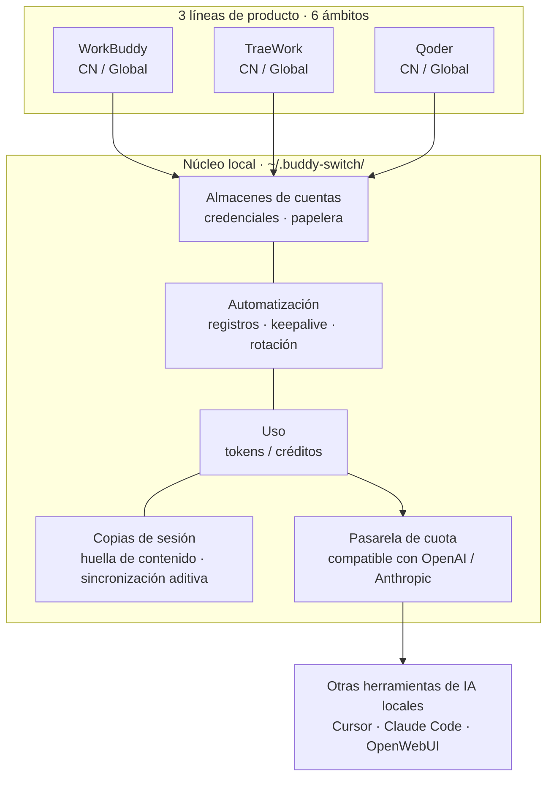
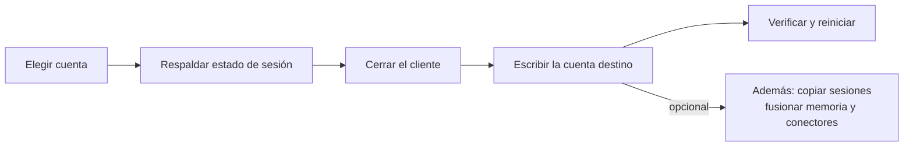
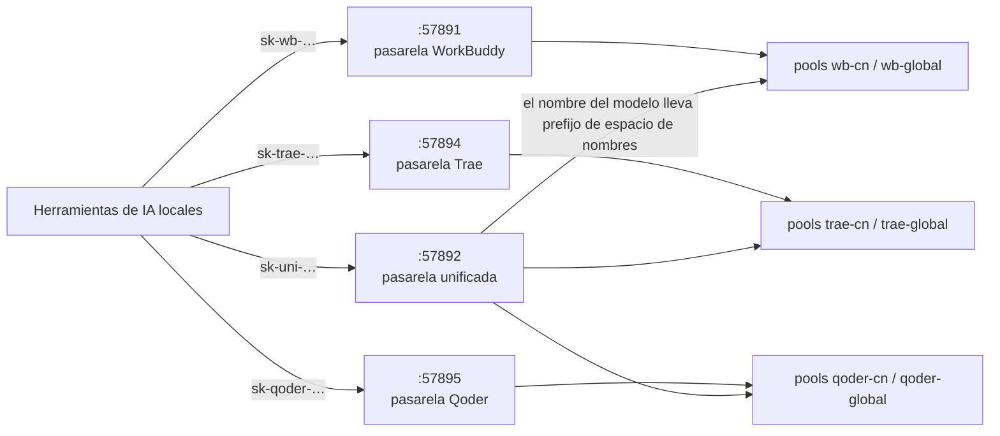
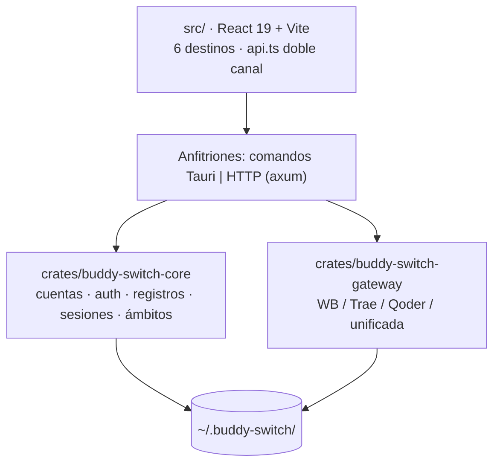

<p align="center">
  
</p>

<p align="center">
  <strong>Buddy Switch</strong><br />
  Estación de trabajo multicuenta para WorkBuddy · CodeBuddy · TraeWork · Qoder
</p>

<p align="center">
  <a href="README.md">简体中文</a> ·
  <a href="README.en.md">English</a> ·
  <a href="README.ja.md">日本語</a> ·
  <a href="README.ko.md">한국어</a> ·
  <a href="README.ru.md">Русский</a> ·
  <a href="README.fr.md">Français</a> ·
  <strong>Español</strong> ·
  <a href="README.pt.md">Português</a>
</p>

# Buddy Switch

Una estación de trabajo multicuenta **totalmente local**: reúne las cuentas de cuatro líneas de producto — **WorkBuddy / CodeBuddy / TraeWork / Qoder** — y **6 ámbitos** en un solo lugar. Inicio de sesión por QR o código de dispositivo, cambio de cuenta en un clic, registros diarios y créditos, analítica de uso, sincronización de copias de sesión y publicación de tu cuota de modelos a otras herramientas de IA locales mediante endpoints compatibles con OpenAI / Anthropic.

> ⚠️ **Herramienta de terceros no oficial** (source-available, licencia PolyForm Noncommercial). Sin afiliación, autorización ni respaldo de esos productos ni de sus titulares. Lee y escribe los datos de autenticación de los clientes locales, envía peticiones automáticas según tu programación y puede reenviar tu cuota por un puerto local. Lee el **[aviso legal](docs/DISCLAIMER.en.md)** antes de usarla.

## Capturas

> Tomadas en una ejecución de demostración (`VITE_DEMO_MODE=1`, capa de red simulada). Cuentas, créditos y peticiones son ficticios.

<table>
  <thead>
    <tr><th>Resumen (claro)</th><th>Resumen (oscuro)</th></tr>
  </thead>
  <tbody>
    <tr>
      <td></td>
      <td></td>
    </tr>
  </tbody>
</table>

<table>
  <thead>
    <tr><th>Cuentas de WorkBuddy (claro)</th><th>Cuentas de WorkBuddy (oscuro)</th></tr>
  </thead>
  <tbody>
    <tr>
      <td></td>
      <td></td>
    </tr>
  </tbody>
</table>

<table>
  <thead>
    <tr><th>Uso · tendencia (claro)</th><th>Uso · tendencia (oscuro)</th></tr>
  </thead>
  <tbody>
    <tr>
      <td></td>
      <td></td>
    </tr>
  </tbody>
</table>

<table>
  <thead>
    <tr><th>Pasarela (claro)</th><th>Pasarela (oscuro)</th></tr>
  </thead>
  <tbody>
    <tr>
      <td></td>
      <td></td>
    </tr>
  </tbody>
</table>

Más pantallas (sesiones / ajustes / cuentas y uso de TraeWork): [docs/images](docs/images).

## Vista general



**Tres reglas firmes** en todo el producto: los datos se quedan en esta máquina, las credenciales solo se escriben en el estado de sesión del cliente (sin inicio de sesión proxy ni cambios en el protocolo del proveedor) y toda escritura se respalda antes.

## Tres formas

| Forma | Cómo obtenerla | Nota |
| --- | --- | --- |
| **Aplicación de escritorio** | Descargar el instalador desde [GitHub Releases](https://github.com/NextAgentX/trae-workbuddy-switch/releases/latest) | Empaquetada con Tauri; recomendada para el día a día |
| **webui** | Compilar desde el código (abajo) | El mismo bundle del frontend, servido por HTTP local |
| **Demo en línea** | [GitHub Pages](https://nextagentx.github.io/trae-workbuddy-switch/) | Demo de solo lectura; cuentas y uso son ficticios |

> El paquete npm aún no está publicado, así que `npm i -g` no lo instalará; para la forma webui usa la compilación desde el código.

## Inicio rápido

**Aplicación de escritorio**: descarga el instalador de tu plataforma desde Releases.

| Plataforma | Instalador | Instalación |
| --- | --- | --- |
| macOS Apple Silicon (arm64) | `BuddySwitch_<versión>_aarch64.dmg` | Abre el DMG y arrastra `BuddySwitch.app` a Aplicaciones |
| macOS Intel (x86_64) | `BuddySwitch_<versión>_x86_64.dmg` | Igual que arriba |
| Windows x64 | `BuddySwitch_<versión>_x64-setup.exe` | Ejecuta el instalador |
| Linux x64 | `BuddySwitch_<versión>_amd64.deb` / `.AppImage` | Instala el `.deb` o da permisos de ejecución al AppImage |

**webui (compilar desde el código)**: el bundle del frontend se incrusta en el servidor **en tiempo de compilación** (`rust-embed`), así que el orden es obligatorio.

```bash
npm install
npm run build                                    # 1) frontend → dist/
cargo build --release -p buddy-switch-server     # 2) compilar el servidor (incrusta dist/)
./target/release/buddy-switch                    # 3) servir y abrir el navegador (127.0.0.1:57890)
```

```bash
buddy-switch              # servir + abrir navegador
buddy-switch serve        # solo servir (--port para el puerto)
buddy-switch status       # cuenta actual en la terminal
buddy-switch version      # versión
```

<details>
<summary><b>macOS: «no se puede verificar al desarrollador» o «sin permisos» al cambiar de cuenta</b></summary>

- No se puede verificar al desarrollador: en Finder, clic con Control sobre la app → Abrir, o Ajustes del Sistema → Privacidad y seguridad → «Abrir igualmente».
- El cambio de cuenta escribe el archivo de autenticación del cliente: concede a BuddySwitch **Gestión de apps** (o **Acceso total al disco**) en Privacidad y seguridad, y reinicia la app. La «comprobación de permisos» de los ajustes lo verifica en cualquier momento.
- En la forma webui, los permisos son los del proceso de terminal que inició el servicio.

</details>

## 6 ámbitos (plataforma × región)

El selector de la esquina superior izquierda decide qué conjunto de cuentas gestionas. El ámbito vive en la URL (`/s/wb-cn/accounts`), así que recargar, compartir el enlace o ir atrás/adelante mantiene la posición; `⌘K` / `Ctrl+K` busca en todos los ámbitos y `⌘1`–`⌘6` cambia directamente.

| Ámbito | Plataforma | Región | Clientes gestionados |
| --- | --- | --- | --- |
| `wb-cn` | WorkBuddy | CN | WorkBuddy de escritorio, CodeBuddy CN IDE / CLI, extensiones CodeBuddy para VS Code / JetBrains |
| `wb-global` | WorkBuddy | Global | Los mismos clientes (versiones globales) |
| `trae-cn` | TraeWork | CN | Trae CN |
| `trae-global` | TraeWork | Global | Trae |
| `qoder-cn` | Qoder | CN | Qoder CN de escritorio / CLI |
| `qoder-global` | Qoder | Global | Qoder de escritorio / CLI |

Los seis ámbitos son **totalmente independientes**: almacenes de cuentas, clientes, configuración y claves de pasarela separados. Las dos líneas antiguas de Trae (TraeWork / TraeCode) se fusionaron aguas arriba en un solo cliente; los identificadores antiguos solo se mantienen por compatibilidad.

## 6 destinos de la barra lateral

Idénticos punto por punto en las tres plataformas: **Resumen · Cuentas · Uso · Sesiones · Pasarela · Ajustes**. Las entradas se filtran por **capacidad** (no por rama de plataforma): sin capacidad no hay entrada, y un acceso directo por URL devuelve un estado vacío estructurado.

| Destino | En una línea |
| --- | --- |
| **Resumen** | Lo que requiere acción (reiniciar sesión / registro de hoy / créditos por caducar / cliente no iniciado) + tarjetas de estadísticas + gráfico de tokens de 14 días + vistazo a otros ámbitos |
| **Cuentas** | Vistas de tarjetas y tabla, ranuras de programa, inicio por QR o código de dispositivo, importación local, registros, papelera (30 días), registro de límites (solo WorkBuddy) |
| **Uso** | Una sola estación con cuatro vistas: tendencia · modelos · sesiones · créditos; una única barra de parámetros (rango + origen de datos) |
| **Sesiones** | Copias de una misma sesión entre cuentas: quién va atrás, quién divergió, a quién sincronizar (**solo WorkBuddy**) |
| **Pasarela** | Pasarelas independientes (una por ámbito) y pasarela unificada (un proveedor para todos los ámbitos) |
| **Ajustes** | Nueve secciones: general · cuenta e inicio de sesión · registros y créditos · pasarela · programaciones · cliente · permisos y diagnóstico · registros de actividad · copia y restauración |

### Matriz de capacidades

| Capacidad | WorkBuddy | TraeWork | Qoder |
| --- | :---: | :---: | :---: |
| Almacén de cuentas / inicio / importación | ✅ QR + importación | ✅ inicio web + JWT | ✅ código de dispositivo + PAT |
| Ranuras de programa | ✅ 5 (4 conmutables + 1 solo lectura) | ✅ 1 (cliente fusionado) | ✅ 2 (escritorio / CLI) |
| Registros / créditos | ✅ con viaje automático y rotación | ✅ | ✅ registro diario + plan / cuota |
| Analítica de uso | ✅ tokens + créditos | ✅ tokens + créditos | ⏳ origen de datos pendiente |
| Sincronización de copias | ✅ huella de contenido + aditiva | — | — |
| Pasarela de cuota | ✅ `:57891` | ✅ `:57894` | ✅ `:57895` |

## Cómo se cambia de cuenta



- **Respaldar antes de escribir**: archivos de autenticación, instantáneas de sesión de Trae y sobrescrituras de sesión dejan siempre una copia para revertir.
- **Verificar después de escribir**: una escritura fallida se revierte automáticamente; si el cliente está en ejecución se rechaza la escritura, para que no reescriba tu estado con el que tiene en memoria.
- **Borrado suave**: la cuenta va a la papelera 30 días y puede restaurarse; el borrado definitivo elimina también credenciales e instantáneas.

## Pasarela de cuota de modelos

Expone la cuota de la cuenta actual a las herramientas locales: compatibilidad OpenAI (`/v1/models`, `/v1/chat/completions`, `/v1/responses`) y Anthropic (`/v1/messages`), ambas con streaming SSE. Por defecto solo escucha en loopback.



- **Cuatro escuchas independientes**: los puertos forman un solo bloque **`5789x`** — `57890` interfaz · `57891` WorkBuddy · `57892` unificada · `57893` hook de sesión · `57894` Trae · `57895` Qoder. Apagar la pasarela unificada no afecta a ningún cliente existente; las rutas `/v1/*` se solapan literalmente, así que **no pueden** fusionarse en un único Router.
- **Los prefijos de clave son una sola familia**: `sk-wb-` · `sk-trae-` · **`sk-qoder-`** · `sk-uni-` — el prefijo ya dice qué puerto configurar.
- **Ciclo de vida de la clave**: revocar · restaurar · eliminar (solo se eliminan las revocadas). El texto plano se devuelve una vez al crearla; el almacén guarda sha256 y los 4 primeros/últimos caracteres.
- **Pool de cuentas**: elige cuentas por saldo y estado de límites, excluye las inutilizables, sondea límites «cuenta × modelo» y las reactiva con un clic.

La **pasarela unificada** resuelve el problema de modelos homónimos que se pisan entre plataformas: el nombre pasa a `<espacio de nombres>:<id del modelo>`, y los espacios de nombres derivan del registro de ámbitos (hoy seis: `wb-cn` / `wb-global` / `trae-cn` / `trae-global` / `qoder-cn` / `qoder-global`).

| Regla | Comportamiento |
| --- | --- |
| Nombre de modelo sin prefijo | **Siempre 400** con la lista de prefijos válidos (sin adivinar un valor por defecto y acabar en el pool equivocado) |
| Análisis del espacio de nombres | **Solo coincidencia exacta del segmento completo** (`trae` / `traework` / `traecode` son prefijos entre sí) |
| Una clave, varias plataformas | Una misma clave `sk-uni-` puede autorizar varias plataformas |
| `/v1/responses` en `trae-*` | **501**, nunca una degradación silenciosa a chat |
| Estado por defecto | **Apagada**; se activa en la sección «Pasarela unificada» de la página de pasarela |

> Arquitectura: [UNIFIED-GATEWAY-ARCH.md](docs/redesign/UNIFIED-GATEWAY-ARCH.md) · Fragmentos de configuración: [GATEWAY-CLIENT-INTEGRATION.md](docs/GATEWAY-CLIENT-INTEGRATION.md)

## Automatización

Las programaciones admiten hora **con precisión de minuto** (p. ej. `09:37`), varias horas y **desfase aleatorio** (±5/15/30 minutos) para repartir las ejecuciones.

| Lado | Tareas |
| --- | --- |
| WorkBuddy (6) | Registro · viaje del gato · mapa de actividad · keepalive del token · vuelta al cole · ave nocturna |
| Trae (2) | Registro · renovación automática de JWT |

<details>
<summary><b>Política de rotación automática (WorkBuddy, evita caducar créditos)</b></summary>

Un bucle en segundo plano fija la cuenta por defecto de **los siguientes arranques de CodeBuddy CLI** en la más urgente (caduca antes y aún tiene créditos). Orden de decisión:

1. Cuenta válida (consulta correcta, no caducada, con saldo)
2. Urgencia (si incluso la más urgente supera `min_urgency_hours`, 72 h por defecto → no cambiar)
3. Ya es el objetivo → no cambiar
4. Enfriamiento (`cooldown_minutes`, 120 por defecto)
5. Protección de actividad (conversación en los últimos `active_guard_minutes`, 30 por defecto → no cambiar)
6. Filtro de valor (saldo por debajo de `min_remaining_credits` → no vale la pena)
7. Antioscilación (diferencia menor que `min_gap_hours`, 24 por defecto → no cambiar)

**Límite de efecto**: solo cambia la cuenta por defecto de sesiones futuras; la sesión en curso no se cambia en caliente — recárgala por ACP o reinicia el CLI.

</details>

<details>
<summary><b>Capacidades de la aplicación (compartidas por los seis ámbitos)</b></summary>

| Capacidad | Descripción |
| --- | --- |
| Ajustes de la app (⚙) | Tema (claro / oscuro / sistema), idioma de la interfaz (简体中文 / English), inicio silencioso en la bandeja, cerrar a la bandeja, actualización automática |
| Copia y restauración globales | Cubren todos los ámbitos a la vez, seleccionables por cuentas / configuración / pasarela, **sin credenciales por defecto** |
| Gestor de Skills | Analiza `skills/*/SKILL.md`, activa/desactiva cada entrada (reescritura línea a línea, resto de bytes intacto), migra entre regiones e importa desde zip |
| Alojamiento de ajustes del cliente | Lee y escribe el `settings.json` del cliente de origen: tabla de seis ranuras, huella de formato, parche mínimo a nivel de byte, copia / restauración / diferencias |
| Ventana de sesiones (solo escritorio) | Ventana pequeña con estados de tareas de varias fuentes; solo lectura, clic para volver a la sesión original |
| Vigilancia de sesiones del cliente (apagada por defecto) | Instala un hook en el `settings.json` de WorkBuddy y envía los estados a la ventana (receptor `127.0.0.1:57893`) |

</details>

## Datos y privacidad

- Todo vive en `~/.buddy-switch/` en esta máquina y no se envía a terceros; las preferencias de interfaz también son locales.
- Los almacenes de cuentas están separados por ámbito (p. ej. `accounts.json` / `accounts.global.json`, `trae/checkin_accounts*.json`).
- Las copias exportadas **no incluyen tokens por defecto**; el texto plano exige marcar una casilla y confirmar dos veces, con aviso de que el archivo permite iniciar sesión directamente.
- Las claves de pasarela solo guardan hash y prefijo; **los datos locales no se versionan** y antes de publicar se escanean patrones de tokens.

## Desarrollo



```bash
npm install
npm run tauri dev     # desarrollo de escritorio
npm run build         # build del frontend + controles de contrato / ámbitos / plataformas
npm run check:api     # solo comprobación del contrato de API
```

```
crates/
  buddy-switch-core/     # cuentas, auth, OAuth, procesos, cambio, sesiones, registros, regiones, módulos Trae / Qoder
  buddy-switch-gateway/  # pasarelas compatibles con OpenAI / Anthropic (cuatro implementaciones)
  buddy-switch-server/   # servidor HTTP + CLI (API axum + frontend incrustado con rust-embed)
src-tauri/               # anfitrión de escritorio (envoltorios finos de Tauri + bandeja + anfitriones de pasarela)
src/                     # frontend: components / pages / lib / locales
npm/                     # paquetes npm (sin publicar)
```

Requisitos de entorno, proceso de publicación y convenciones de directorios: [docs/DEVELOPMENT.md](docs/DEVELOPMENT.md).

## Contribuir

Issues, documentación, corrección de errores y PR de funcionalidades son bienvenidos — consulta **[CONTRIBUTING.en.md](CONTRIBUTING.en.md)** ([简体中文](CONTRIBUTING.md)) para la lista de comprobación y las convenciones.

## Apoyar el proyecto

<table>
  <thead>
    <tr><th>WeChat Pay</th><th>Alipay</th></tr>
  </thead>
  <tbody>
    <tr>
      <td></td>
      <td></td>
    </tr>
  </tbody>
</table>

## Agradecimientos

- [changexbc/workbuddy-switch](https://github.com/changexbc/workbuddy-switch) — por el formato de datos de cuenta de WorkBuddy y el enfoque de cambio multicuenta.
- [Sliverkiss/workbuddy2api](https://github.com/Sliverkiss/workbuddy2api) — por la idea de exponer la cuota de modelos como servicio compatible con OpenAI.

Cada proyecto sigue su propia licencia. Este proyecto es una implementación independiente, sin afiliación ni respaldo; los nombres y marcas pertenecen a sus titulares.

## Aviso legal

Texto completo en **[docs/DISCLAIMER.en.md](docs/DISCLAIMER.en.md)** ([简体中文](docs/DISCLAIMER.md)), seis apartados: herramienta de terceros no oficial; términos de servicio y cumplimiento; escritura de datos y copias; riesgos de la automatización; riesgos de exponer la pasarela API; provista «tal cual». Usar el proyecto implica aceptarlos; si no, deja de usarlo y desinstálalo.

## Licencia

**[PolyForm Noncommercial License 1.0.0](./LICENSE)**: se permite el uso personal no comercial, **el uso comercial no está licenciado**.

- Texto completo: [LICENSE](./LICENSE)
- Explicación sencilla y preguntas frecuentes: [docs/LICENSING.en.md](docs/LICENSING.en.md) ([简体中文](docs/LICENSING.md))
- Para licencia comercial, contacta al autor mediante los Issues del repositorio.

## Historial de estrellas

<a href="https://www.star-history.com/?repos=NextAgentX%2Ftrae-workbuddy-switch&type=date&legend=top-left">

 <picture>
   <source media="(prefers-color-scheme: dark)" srcset="https://api.star-history.com/chart?repos=NextAgentX/trae-workbuddy-switch&type=date&theme=dark&legend=top-left" />
   <source media="(prefers-color-scheme: light)" srcset="https://api.star-history.com/chart?repos=NextAgentX/trae-workbuddy-switch&type=date&legend=top-left" />
   
 </picture>
</a>
