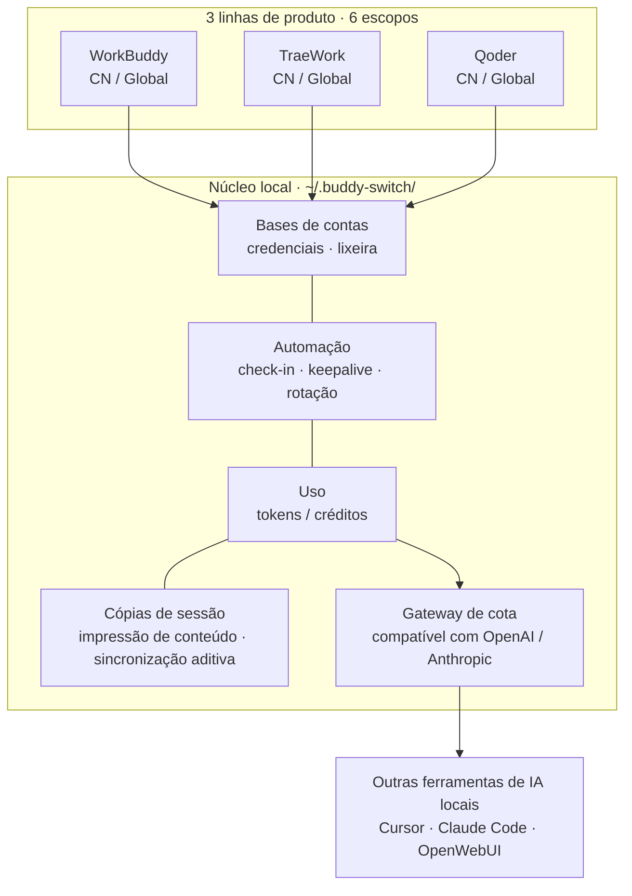
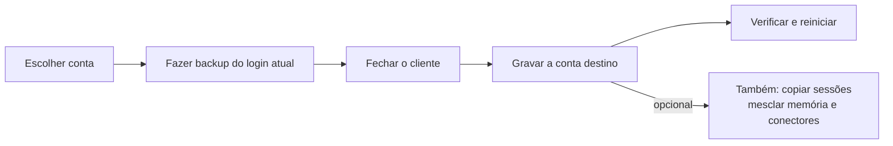
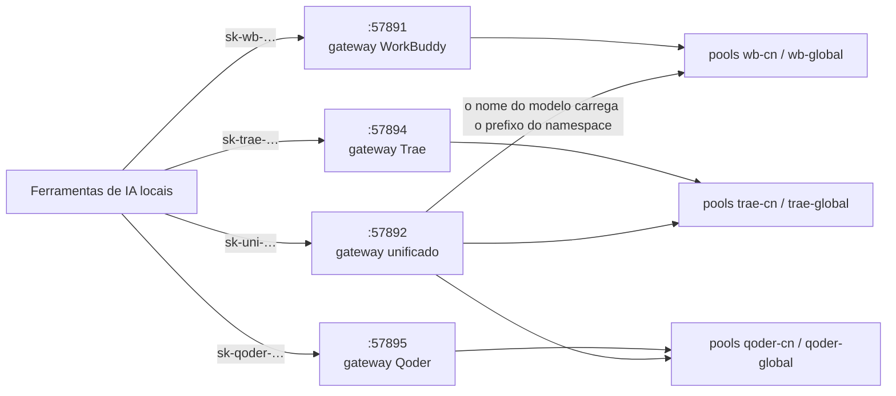
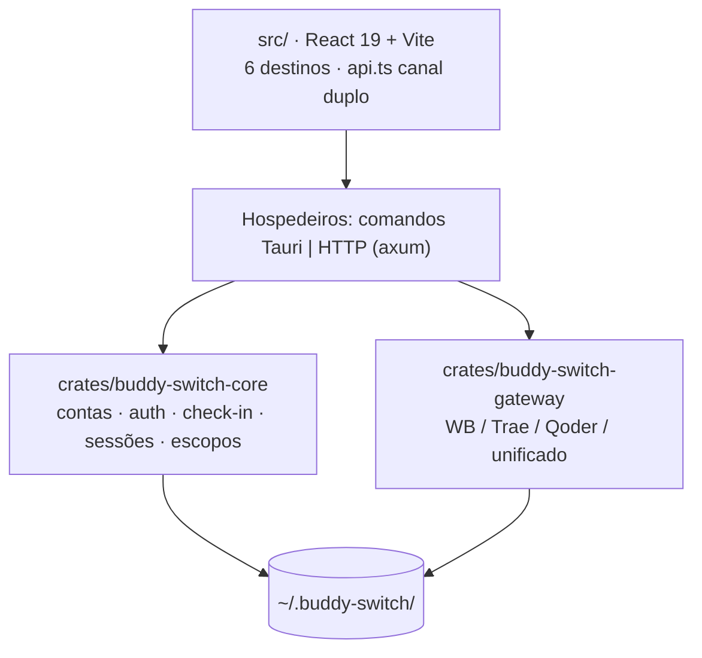

<p align="center">
  
</p>

<p align="center">
  <strong>Buddy Switch</strong><br />
  Estação de trabalho multicuenta para WorkBuddy · CodeBuddy · TraeWork · Qoder
</p>

<p align="center">
  <a href="README.md">简体中文</a> ·
  <a href="README.en.md">English</a> ·
  <a href="README.ja.md">日本語</a> ·
  <a href="README.ko.md">한국어</a> ·
  <a href="README.ru.md">Русский</a> ·
  <a href="README.fr.md">Français</a> ·
  <a href="README.es.md">Español</a> ·
  <strong>Português</strong>
</p>

# Buddy Switch

Uma estação de trabalho multicuenta **totalmente local**: reúne as contas de quatro linhas de produto — **WorkBuddy / CodeBuddy / TraeWork / Qoder** — e **6 escopos** num só lugar. Login por QR code ou código de dispositivo, troca de conta em um clique, check-in diário e créditos, análise de uso, sincronização de cópias de sessão — e exposição da sua cota de modelos a outras ferramentas de IA locais por endpoints compatíveis com OpenAI / Anthropic.

> ⚠️ **Ferramenta de terceiros não oficial** (source-available, licença PolyForm Noncommercial). Sem vínculo, autorização ou endosso desses produtos ou de seus titulares. Ela lê e grava os dados de autenticação dos clientes locais, envia requisições automáticas conforme sua programação e pode encaminhar sua cota por uma porta local. Leia o **[aviso legal](docs/DISCLAIMER.en.md)** antes de usar.

## Capturas de tela

> Obtidas em execução de demonstração (`VITE_DEMO_MODE=1`, camada de rede simulada). Contas, créditos e requisições são fictícios.

<table>
  <thead>
    <tr><th>Visão geral (claro)</th><th>Visão geral (escuro)</th></tr>
  </thead>
  <tbody>
    <tr>
      <td></td>
      <td></td>
    </tr>
  </tbody>
</table>

<table>
  <thead>
    <tr><th>Contas do WorkBuddy (claro)</th><th>Contas do WorkBuddy (escuro)</th></tr>
  </thead>
  <tbody>
    <tr>
      <td></td>
      <td></td>
    </tr>
  </tbody>
</table>

<table>
  <thead>
    <tr><th>Uso · tendência (claro)</th><th>Uso · tendência (escuro)</th></tr>
  </thead>
  <tbody>
    <tr>
      <td></td>
      <td></td>
    </tr>
  </tbody>
</table>

<table>
  <thead>
    <tr><th>Gateway (claro)</th><th>Gateway (escuro)</th></tr>
  </thead>
  <tbody>
    <tr>
      <td></td>
      <td></td>
    </tr>
  </tbody>
</table>

Outras telas (sessões / configurações / contas e uso do TraeWork): [docs/images](docs/images).

## Visão geral



**Três regras firmes** valem em todo o produto: os dados ficam nesta máquina, as credenciais são apenas gravadas no estado de login do cliente (sem login por procuração nem mudanças no protocolo do provedor) e toda gravação é precedida de backup.

## Três formas

| Forma | Como obter | Observação |
| --- | --- | --- |
| **Aplicativo desktop** | Baixar o instalador em [GitHub Releases](https://github.com/NextAgentX/trae-workbuddy-switch/releases/latest) | Empacotado com Tauri; recomendado no dia a dia |
| **webui** | Compilar do código-fonte (abaixo) | O mesmo bundle de frontend do app, servido por HTTP local |
| **Demo online** | [GitHub Pages](https://nextagentx.github.io/trae-workbuddy-switch/) | Demo somente leitura; contas e uso são fictícios |

> O pacote npm ainda não foi publicado, então `npm i -g` não o instala; para a forma webui use a compilação do código-fonte abaixo.

## Início rápido

**Aplicativo desktop**: baixe o instalador da sua plataforma em Releases.

| Plataforma | Instalador | Instalação |
| --- | --- | --- |
| macOS Apple Silicon (arm64) | `BuddySwitch_<versão>_aarch64.dmg` | Abra o DMG e arraste `BuddySwitch.app` para Aplicativos |
| macOS Intel (x86_64) | `BuddySwitch_<versão>_x86_64.dmg` | Igual ao acima |
| Windows x64 | `BuddySwitch_<versão>_x64-setup.exe` | Execute o instalador |
| Linux x64 | `BuddySwitch_<versão>_amd64.deb` / `.AppImage` | Instale o `.deb` ou dê permissão de execução ao AppImage |

**webui (compilar do código-fonte)**: o bundle do frontend é embutido no servidor **em tempo de compilação** (`rust-embed`), então a ordem é obrigatória.

```bash
npm install
npm run build                                    # 1) frontend → dist/
cargo build --release -p buddy-switch-server     # 2) compilar o servidor (embute dist/)
./target/release/buddy-switch                    # 3) servir e abrir o navegador (127.0.0.1:57890)
```

```bash
buddy-switch              # servir + abrir navegador
buddy-switch serve        # somente servir (--port para a porta)
buddy-switch status       # conta atual no terminal
buddy-switch version      # versão
```

<details>
<summary><b>macOS: «não é possível verificar o desenvolvedor» ou «sem permissão» ao trocar de conta</b></summary>

- Não é possível verificar o desenvolvedor: no Finder, clique com a tecla Control no app → Abrir, ou Ajustes do Sistema → Privacidade e Segurança → «Abrir assim mesmo».
- A troca de conta grava o arquivo de autenticação do cliente: conceda ao BuddySwitch **Gerenciamento de Apps** (ou **Acesso Total ao Disco**) em Privacidade e Segurança e reinicie o app. A «verificação de permissões» dos ajustes confirma a qualquer momento.
- Na forma webui, as permissões são as do processo de terminal que iniciou o serviço.

</details>

## 6 escopos (plataforma × região)

O seletor no canto superior esquerdo define qual conjunto de contas você gerencia. O escopo fica na URL (`/s/wb-cn/accounts`), então recarregar, compartilhar o link ou voltar/avançar mantém a posição; `⌘K` / `Ctrl+K` pesquisa em todos os escopos e `⌘1`–`⌘6` troca direto.

| Escopo | Plataforma | Região | Clientes gerenciados |
| --- | --- | --- | --- |
| `wb-cn` | WorkBuddy | CN | WorkBuddy desktop, CodeBuddy CN IDE / CLI, extensões CodeBuddy para VS Code / JetBrains |
| `wb-global` | WorkBuddy | Global | Os mesmos clientes (versões globais) |
| `trae-cn` | TraeWork | CN | Trae CN |
| `trae-global` | TraeWork | Global | Trae |
| `qoder-cn` | Qoder | CN | Qoder CN desktop / CLI |
| `qoder-global` | Qoder | Global | Qoder desktop / CLI |

Os seis escopos são **totalmente independentes**: bases de contas, clientes, configuração e chaves de gateway separados. As duas linhas antigas do Trae (TraeWork / TraeCode) foram fundidas upstream em um único cliente; os identificadores antigos permanecem apenas por compatibilidade.

## 6 destinos da barra lateral

Idênticos ponto a ponto nas três plataformas: **Visão geral · Contas · Uso · Sessões · Gateway · Configurações**. As entradas são filtradas por **capacidade** (não por ramificação de plataforma): sem capacidade, sem entrada — e o acesso direto por URL devolve um estado vazio estruturado.

| Destino | Em uma linha |
| --- | --- |
| **Visão geral** | O que precisa de ação (relogin / check-in de hoje / créditos expirando / cliente não iniciado) + cartões de estatística + gráfico de tokens de 14 dias + resumo dos outros escopos |
| **Contas** | Visões de cartões e tabela, slots de programa, login por QR ou código de dispositivo, importação local, check-in, lixeira (30 dias), registro de limites (somente WorkBuddy) |
| **Uso** | Uma estação com quatro visões: tendência · modelos · sessões · créditos; uma única barra de parâmetros (período + fonte de dados) |
| **Sessões** | Cópias de uma mesma sessão entre contas: quem está atrás, quem divergiu, para quem sincronizar (**somente WorkBuddy**) |
| **Gateway** | Gateways independentes (um por escopo) e gateway unificado (um provedor para todos os escopos) |
| **Configurações** | Nove seções: geral · conta e login · check-in e créditos · gateway · agendamentos · cliente · permissões e diagnóstico · logs · backup e restauração |

### Matriz de capacidades

| Capacidade | WorkBuddy | TraeWork | Qoder |
| --- | :---: | :---: | :---: |
| Base de contas / login / importação | ✅ QR + importação | ✅ login web + JWT | ✅ código de dispositivo + PAT |
| Slots de programa | ✅ 5 (4 alternáveis + 1 somente leitura) | ✅ 1 (cliente fundido) | ✅ 2 (desktop / CLI) |
| Check-in / créditos | ✅ com viagem automática e rotação | ✅ | ✅ check-in diário + plano / cota |
| Análise de uso | ✅ tokens + créditos | ✅ tokens + créditos | ⏳ fonte de dados pendente |
| Sincronização de cópias | ✅ impressão de conteúdo + aditiva | — | — |
| Gateway de cota | ✅ `:57891` | ✅ `:57894` | ✅ `:57895` |

## Como a troca de conta funciona



- **Backup antes da gravação**: arquivos de autenticação, snapshots de login do Trae e sobrescritas de sessão sempre deixam uma cópia para reverter.
- **Verificação após a gravação**: uma gravação malsucedida é revertida automaticamente; com o cliente em execução a gravação é recusada, para que ele não sobrescreva tudo com o estado em memória.
- **Exclusão suave**: a conta vai para a lixeira por 30 dias e pode ser restaurada; a exclusão definitiva remove também credenciais e snapshots.

## Gateway de cota de modelos

Expõe a cota da conta atual para ferramentas locais: compatibilidade OpenAI (`/v1/models`, `/v1/chat/completions`, `/v1/responses`) e Anthropic (`/v1/messages`), ambas com streaming SSE. Por padrão escuta apenas em loopback.



- **Quatro escutas independentes**: as portas formam um único bloco **`5789x`** — `57890` interface · `57891` WorkBuddy · `57892` unificado · `57893` hook de sessão · `57894` Trae · `57895` Qoder. Desligar o gateway unificado não afeta nenhum cliente existente; as rotas `/v1/*` se sobrepõem literalmente, então **não podem** ser fundidas em um único Router.
- **Os prefixos de chave são uma só família**: `sk-wb-` · `sk-trae-` · **`sk-qoder-`** · `sk-uni-` — o prefixo já diz qual porta configurar.
- **Ciclo da chave**: revogar · restaurar · excluir (só revogadas podem ser excluídas). O texto puro é devolvido uma vez na criação; a base guarda sha256 e os 4 primeiros/últimos caracteres.
- **Pool de contas**: escolhe contas por saldo e estado de limite, exclui as inutilizáveis, sonda limites «conta × modelo» e as reativa em um clique.

O **gateway unificado** resolve o problema de modelos homônimos se sobrescrevendo entre plataformas: o nome passa a `<namespace>:<id do modelo>`, com namespaces derivados do registro de escopos (hoje seis: `wb-cn` / `wb-global` / `trae-cn` / `trae-global` / `qoder-cn` / `qoder-global`).

| Regra | Comportamento |
| --- | --- |
| Nome de modelo sem prefixo | **Sempre 400** com a lista de prefixos válidos (sem adivinhar um padrão e cair no pool errado em silêncio) |
| Análise do namespace | **Somente correspondência exata do segmento inteiro** (`trae` / `traework` / `traecode` são prefixos entre si) |
| Uma chave, várias plataformas | A mesma chave `sk-uni-` pode autorizar várias plataformas |
| `/v1/responses` em `trae-*` | **501**, nunca rebaixamento silencioso para chat |
| Estado padrão | **Desligado**; ative na seção «Gateway unificado» da página de gateway |

> Arquitetura: [UNIFIED-GATEWAY-ARCH.md](docs/redesign/UNIFIED-GATEWAY-ARCH.md) · Trechos de configuração: [GATEWAY-CLIENT-INTEGRATION.md](docs/GATEWAY-CLIENT-INTEGRATION.md)

## Automação

Os agendamentos aceitam horário **com precisão de minuto** (ex.: `09:37`), vários horários e **jitter aleatório** (±5/15/30 minutos) para espalhar as execuções.

| Lado | Tarefas |
| --- | --- |
| WorkBuddy (6) | Check-in · viagem do gato · mapa de atividade · keepalive do token · volta às aulas · coruja noturna |
| Trae (2) | Check-in · renovação automática de JWT |

<details>
<summary><b>Política de rotação automática (WorkBuddy, evita expirar créditos)</b></summary>

Um laço em segundo plano define a conta padrão das **próximas inicializações do CodeBuddy CLI** como a mais urgente (expira antes e ainda tem créditos). Ordem de decisão:

1. Conta válida (consulta ok, não expirada, com saldo)
2. Urgência (se até a mais urgente passa de `min_urgency_hours`, 72 h por padrão → não troca)
3. Já é o alvo → não troca
4. Cooldown (`cooldown_minutes`, 120 por padrão)
5. Proteção de atividade (conversa nos últimos `active_guard_minutes`, 30 por padrão → não troca)
6. Filtro de valor (saldo abaixo de `min_remaining_credits` → não vale a pena)
7. Anti-oscilação (diferença menor que `min_gap_hours`, 24 por padrão → não troca)

**Limite de efeito**: apenas a conta padrão de sessões futuras muda; a sessão em execução não é trocada a quente — recarregue pelo ACP ou reinicie o CLI.

</details>

<details>
<summary><b>Capacidades do aplicativo (comuns aos seis escopos)</b></summary>

| Capacidade | Descrição |
| --- | --- |
| Configurações do app (⚙) | Tema (claro / escuro / sistema), idioma da interface (简体中文 / English), início silencioso na bandeja, fechar para a bandeja, atualização automática |
| Backup e restauração globais | Cobrem todos os escopos de uma vez, selecionáveis por contas / configuração / gateway, **sem credenciais por padrão** |
| Gerenciador de Skills | Varre `skills/*/SKILL.md`, ativa/desativa cada item (reescrita linha a linha, demais bytes preservados), migra entre regiões e importa de zip |
| Hospedagem de configurações do cliente | Lê e grava o `settings.json` do cliente de origem: tabela de seis slots, impressão de formato, patch mínimo em bytes, backup / restauração / diferenças |
| Janela de sessões (somente desktop) | Pequena janela sempre visível com estados de tarefas de várias origens; somente leitura, clique para voltar à sessão original |
| Monitoramento de sessões do cliente (desligado por padrão) | Instala um hook no `settings.json` do WorkBuddy e envia estados de tarefas para a janela (receptor `127.0.0.1:57893`) |

</details>

## Dados e privacidade

- Tudo fica em `~/.buddy-switch/` nesta máquina e não é enviado a terceiros; as preferências de interface também são locais.
- As bases de contas são separadas por escopo (ex.: `accounts.json` / `accounts.global.json`, `trae/checkin_accounts*.json`).
- Os backups exportados **não contêm tokens por padrão**; o texto puro exige marcação explícita e segunda confirmação, com aviso de que o arquivo permite login direto.
- As chaves de gateway guardam apenas hash e prefixo; **dados locais nunca são versionados** e padrões de token são varridos antes de cada release.

## Desenvolvimento



```bash
npm install
npm run tauri dev     # desenvolvimento desktop
npm run build         # build do frontend + checagens de contrato / escopos / plataformas
npm run check:api     # apenas checagem do contrato de API
```

```
crates/
  buddy-switch-core/     # contas, auth, OAuth, processos, troca, sessões, check-in, regiões, módulos Trae / Qoder
  buddy-switch-gateway/  # gateways compatíveis com OpenAI / Anthropic (quatro implementações)
  buddy-switch-server/   # servidor HTTP + CLI (API axum + frontend embutido com rust-embed)
src-tauri/               # hospedeiro desktop (invólucros finos do Tauri + bandeja + hospedeiros de gateway)
src/                     # frontend: components / pages / lib / locales
npm/                     # pacotes npm (não publicados)
```

Requisitos de ambiente, processo de release e convenções de diretórios: [docs/DEVELOPMENT.md](docs/DEVELOPMENT.md).

## Contribuindo

Issues, documentação, correções de bugs e PRs de funcionalidades são bem-vindos — veja **[CONTRIBUTING.en.md](CONTRIBUTING.en.md)** ([简体中文](CONTRIBUTING.md)) para a checklist e as convenções.

## Apoiar o projeto

<table>
  <thead>
    <tr><th>WeChat Pay</th><th>Alipay</th></tr>
  </thead>
  <tbody>
    <tr>
      <td></td>
      <td></td>
    </tr>
  </tbody>
</table>

## Agradecimentos

- [changexbc/workbuddy-switch](https://github.com/changexbc/workbuddy-switch) — pelo formato de dados de conta do WorkBuddy e pela abordagem de troca multicuenta.
- [Sliverkiss/workbuddy2api](https://github.com/Sliverkiss/workbuddy2api) — pela ideia de expor a cota de modelos como serviço compatível com OpenAI.

Cada projeto segue sua própria licença. Este projeto é uma implementação independente, sem vínculo ou endosso; nomes e marcas pertencem aos seus titulares.

## Aviso legal

Texto completo em **[docs/DISCLAIMER.en.md](docs/DISCLAIMER.en.md)** ([简体中文](docs/DISCLAIMER.md)), seis seções: ferramenta de terceiros não oficial; termos de serviço e conformidade; gravação de dados e backups; riscos da automação; riscos de exposição do gateway de API; fornecida «no estado em que se encontra». Usar o projeto implica concordância; caso contrário, pare de usar e desinstale.

## Licença

**[PolyForm Noncommercial License 1.0.0](./LICENSE)**: uso pessoal não comercial é permitido, **uso comercial não é licenciado**.

- Texto completo: [LICENSE](./LICENSE)
- Explicação em linguagem simples e FAQ: [docs/LICENSING.en.md](docs/LICENSING.en.md) ([简体中文](docs/LICENSING.md))
- Para licença comercial, contate o autor pelas Issues do repositório.

## Histórico de estrelas

<a href="https://www.star-history.com/?repos=NextAgentX%2Ftrae-workbuddy-switch&type=date&legend=top-left">

 <picture>
   <source media="(prefers-color-scheme: dark)" srcset="https://api.star-history.com/chart?repos=NextAgentX/trae-workbuddy-switch&type=date&theme=dark&legend=top-left" />
   <source media="(prefers-color-scheme: light)" srcset="https://api.star-history.com/chart?repos=NextAgentX/trae-workbuddy-switch&type=date&legend=top-left" />
   
 </picture>
</a>
