<p align="center">
  
</p>

<p align="center">
  <strong>Buddy Switch</strong><br />
  Мультиаккаунтная среда для WorkBuddy · CodeBuddy · TraeWork · Qoder
</p>

<p align="center">
  <a href="README.md">简体中文</a> ·
  <a href="README.en.md">English</a> ·
  <a href="README.ja.md">日本語</a> ·
  <a href="README.ko.md">한국어</a> ·
  <strong>Русский</strong> ·
  <a href="README.fr.md">Français</a> ·
  <a href="README.es.md">Español</a> ·
  <a href="README.pt.md">Português</a>
</p>

# Buddy Switch

**Полностью локальная** среда для работы с несколькими аккаунтами: собирает аккаунты четырёх продуктовых линеек — **WorkBuddy / CodeBuddy / TraeWork / Qoder** — и **6 областей (scope)** в одном месте. Вход по QR-коду или коду устройства, переключение аккаунта одним кликом, ежедневные отметки и кредиты, аналитика расхода, синхронизация копий сессий — плюс публикация квоты моделей другим локальным AI-инструментам через OpenAI / Anthropic-совместимые эндпоинты.

> ⚠️ **Неофициальный сторонний инструмент** (source-available, лицензия PolyForm Noncommercial). Не связан с перечисленными продуктами и их правообладателями, не авторизован и не одобрен ими. Он читает и изменяет файлы аутентификации локальных клиентов, отправляет автоматические запросы по вашему расписанию и может передавать квоту через локальный порт. Перед использованием прочитайте **[отказ от ответственности](docs/DISCLAIMER.en.md)**.

## Скриншоты

> Сняты в демо-режиме (`VITE_DEMO_MODE=1`, слой запросов замокан). Аккаунты, кредиты и записи запросов вымышлены.

<table>
  <thead>
    <tr><th>Обзор (светлая тема)</th><th>Обзор (тёмная тема)</th></tr>
  </thead>
  <tbody>
    <tr>
      <td>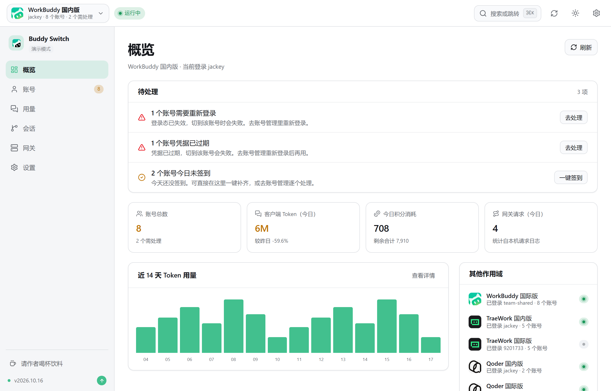</td>
      <td>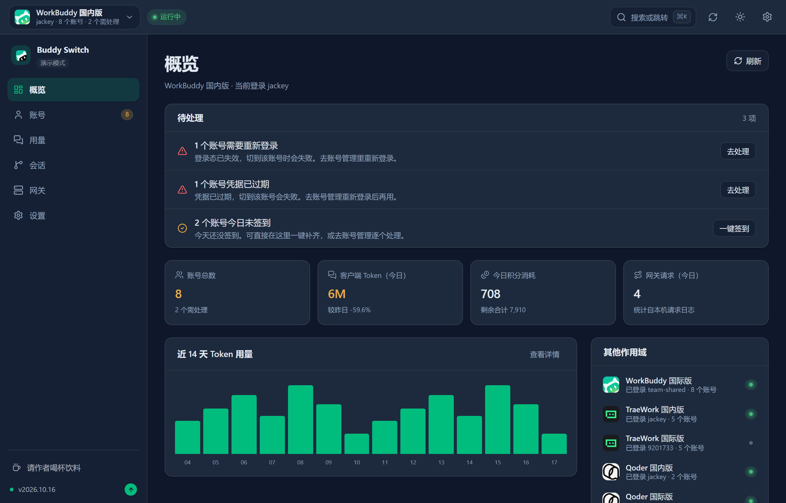</td>
    </tr>
  </tbody>
</table>

<table>
  <thead>
    <tr><th>Аккаунты WorkBuddy (светлая)</th><th>Аккаунты WorkBuddy (тёмная)</th></tr>
  </thead>
  <tbody>
    <tr>
      <td>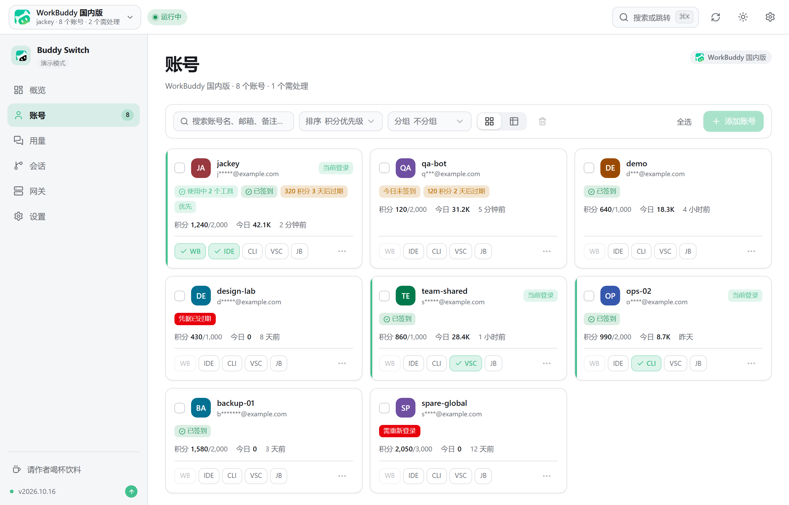</td>
      <td>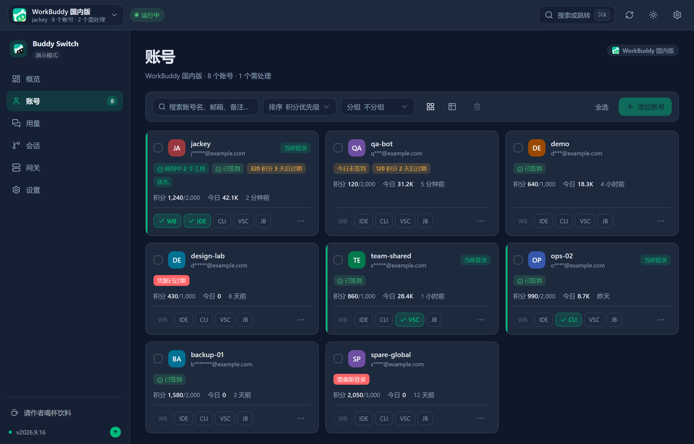</td>
    </tr>
  </tbody>
</table>

<table>
  <thead>
    <tr><th>Расход · динамика (светлая)</th><th>Расход · динамика (тёмная)</th></tr>
  </thead>
  <tbody>
    <tr>
      <td>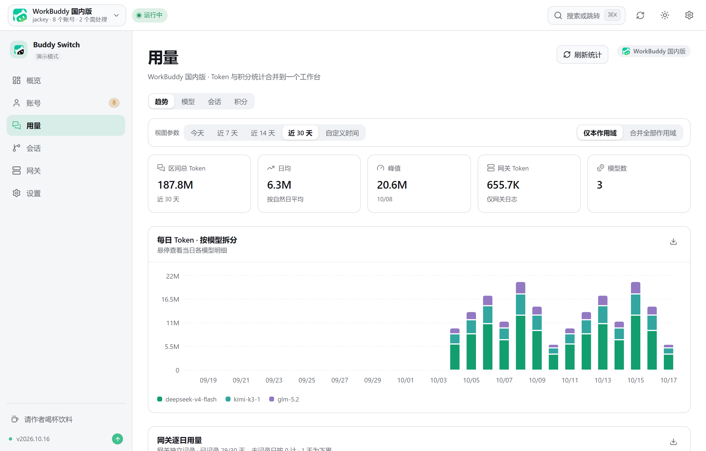</td>
      <td>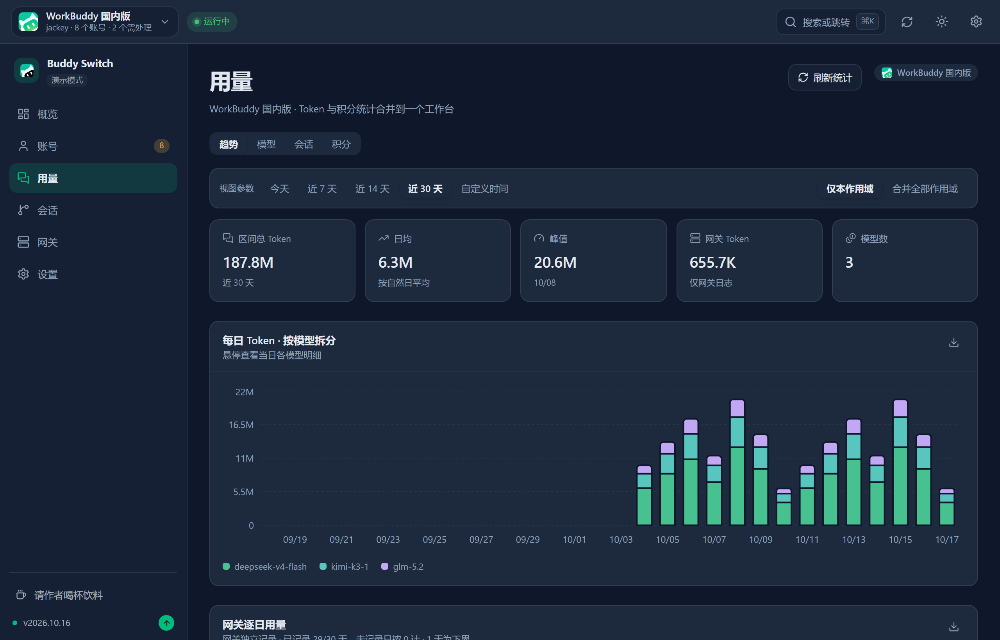</td>
    </tr>
  </tbody>
</table>

<table>
  <thead>
    <tr><th>Шлюз (светлая)</th><th>Шлюз (тёмная)</th></tr>
  </thead>
  <tbody>
    <tr>
      <td>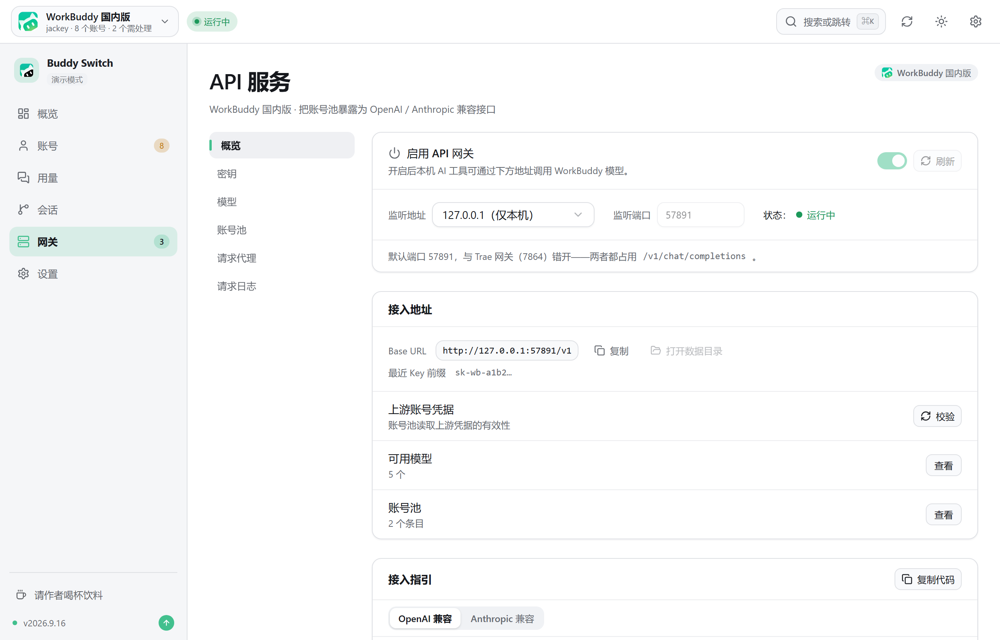</td>
      <td>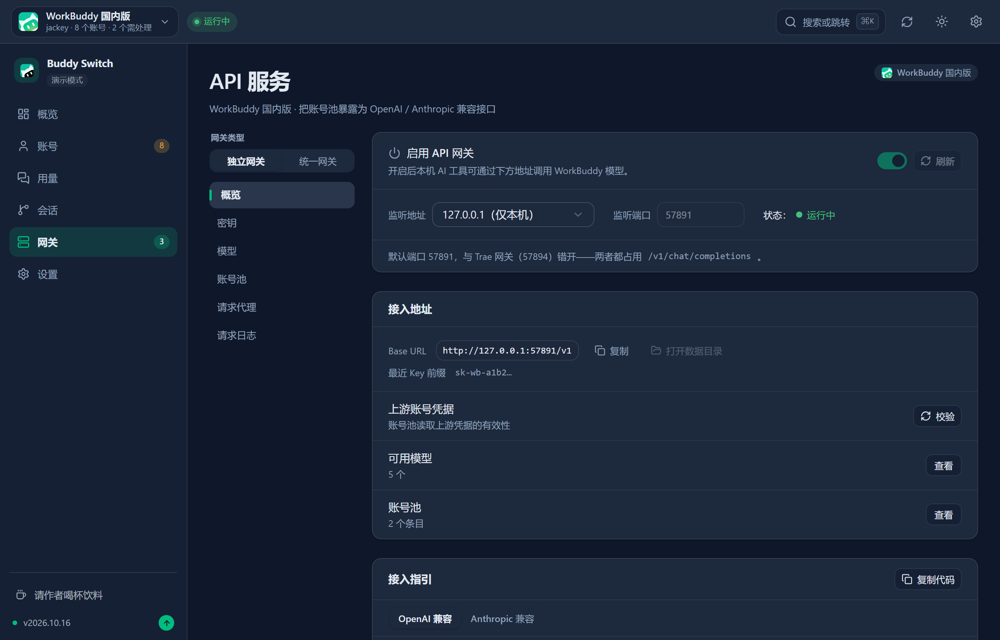</td>
    </tr>
  </tbody>
</table>

Другие экраны (сессии / настройки / аккаунты и расход TraeWork): [docs/images](docs/images).

## Общая схема

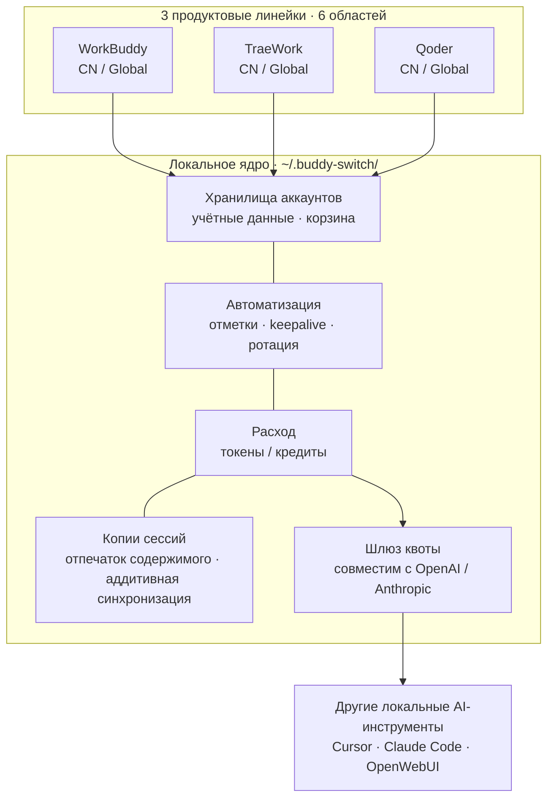

**Три жёстких правила** действуют везде: данные остаются на этой машине, учётные данные только записываются в состояние входа клиента (без прокси-входа и без вмешательства в протоколы), любая запись выполняется после резервного копирования.

## Три формы

| Форма | Как получить | Примечание |
| --- | --- | --- |
| **Настольное приложение** | Скачать установщик из [GitHub Releases](https://github.com/NextAgentX/trae-workbuddy-switch/releases/latest) | Собрано на Tauri; рекомендуется для повседневной работы |
| **webui** | Собрать из исходников (ниже) | Тот же фронтенд, что и в приложении, но по локальному HTTP |
| **Онлайн-демо** | [GitHub Pages](https://nextagentx.github.io/trae-workbuddy-switch/) | Только для просмотра; аккаунты и расход вымышлены |

> Пакет npm ещё не опубликован, поэтому `npm i -g` его не установит — для webui используйте сборку из исходников.

## Быстрый старт

**Настольное приложение**: скачайте установщик для своей платформы из Releases.

| Платформа | Установщик | Установка |
| --- | --- | --- |
| macOS Apple Silicon (arm64) | `BuddySwitch_<версия>_aarch64.dmg` | Откройте DMG и перетащите `BuddySwitch.app` в «Программы» |
| macOS Intel (x86_64) | `BuddySwitch_<версия>_x86_64.dmg` | То же самое |
| Windows x64 | `BuddySwitch_<версия>_x64-setup.exe` | Запустите установщик |
| Linux x64 | `BuddySwitch_<версия>_amd64.deb` / `.AppImage` | Установите `.deb` либо выдайте права на запуск AppImage |

**webui (сборка из исходников)**: фронтенд встраивается в сервер **на этапе компиляции** (`rust-embed`), поэтому порядок важен.

```bash
npm install
npm run build                                    # 1) фронтенд → dist/
cargo build --release -p buddy-switch-server     # 2) сборка сервера (встраивает dist/)
./target/release/buddy-switch                    # 3) запуск + открытие браузера (127.0.0.1:57890)
```

```bash
buddy-switch              # запуск сервиса + браузер
buddy-switch serve        # только сервис (--port для порта)
buddy-switch status       # текущий аккаунт в терминале
buddy-switch version      # версия
```

<details>
<summary><b>macOS: «разработчик не подтверждён» / нет прав при переключении</b></summary>

- «Разработчик не подтверждён»: в Finder щёлкните по приложению с зажатым Control → «Открыть», либо «Системные настройки → Конфиденциальность и безопасность» → «Всё равно открыть».
- Переключение аккаунта записывает файл аутентификации клиента: выдайте BuddySwitch разрешение **«Управление приложениями»** (или **«Полный доступ к диску»**) в разделе «Конфиденциальность и безопасность», затем перезапустите приложение. Проверка прав доступна в настройках в любой момент.
- В форме webui права наследуются от процесса терминала, запустившего сервис.

</details>

## 6 областей (платформа × регион)

Селектор области в левом верхнем углу определяет, каким набором аккаунтов вы управляете. Область хранится в URL (`/s/wb-cn/accounts`), поэтому обновление страницы, ссылки и навигация назад/вперёд сохраняют позицию; `⌘K` / `Ctrl+K` ищет по всем областям, `⌘1`–`⌘6` переключают напрямую.

| Область | Платформа | Регион | Управляемые клиенты |
| --- | --- | --- | --- |
| `wb-cn` | WorkBuddy | CN | WorkBuddy для рабочего стола, CodeBuddy CN IDE / CLI, расширения CodeBuddy для VS Code / JetBrains |
| `wb-global` | WorkBuddy | Global | Те же клиенты (глобальные сборки) |
| `trae-cn` | TraeWork | CN | Trae CN |
| `trae-global` | TraeWork | Global | Trae |
| `qoder-cn` | Qoder | CN | Qoder CN для рабочего стола / CLI |
| `qoder-global` | Qoder | Global | Qoder для рабочего стола / CLI |

Шесть областей **полностью независимы**: отдельные хранилища аккаунтов, клиенты, конфигурация и ключи шлюза. Две прежние программные линии Trae (TraeWork / TraeCode) объединены upstream в один клиент; старые идентификаторы оставлены только для совместимости.

## 6 разделов боковой панели

Одинаково для всех трёх платформ: **Обзор · Аккаунты · Расход · Сессии · Шлюз · Настройки**. Пункты включаются **по возможностям** (а не по ветвлению платформы): нет возможности — нет пункта, а прямой переход по URL даёт структурированное пустое состояние.

| Раздел | Кратко |
| --- | --- |
| **Обзор** | Что требует внимания (повторный вход / нет отметки за сегодня / истекающие кредиты / клиент не запущен) + карточки статистики + график токенов за 14 дней + сводка по другим областям |
| **Аккаунты** | Карточки и таблица, программные слоты, вход по QR или коду устройства, импорт с машины, отметки, корзина (30 дней), реестр лимитов клиента (только WorkBuddy) |
| **Расход** | Одна среда, четыре вида: динамика · модели · сессии · кредиты; единственная панель параметров (период + источник данных) |
| **Сессии** | Копии одной сессии в разных аккаунтах: кто отстал, кто разошёлся, кому синхронизировать (**только WorkBuddy**) |
| **Шлюз** | Независимые шлюзы (по одному на область) и единый шлюз (один провайдер на все области) |
| **Настройки** | Девять разделов: общие · аккаунт и вход · отметки и кредиты · шлюз · расписания · клиент · права и диагностика · журналы · резервные копии |

### Матрица возможностей

| Возможность | WorkBuddy | TraeWork | Qoder |
| --- | :---: | :---: | :---: |
| Хранилище аккаунтов / вход / импорт | ✅ QR + импорт | ✅ веб-вход + JWT | ✅ код устройства + PAT |
| Программные слоты | ✅ 5 (4 переключаемых + 1 только чтение) | ✅ 1 (объединённый клиент) | ✅ 2 (приложение / CLI) |
| Отметки / кредиты | ✅ включая авто-путешествия и ротацию | ✅ | ✅ ежедневная отметка + план / квота |
| Аналитика расхода | ✅ токены + кредиты | ✅ токены + кредиты | ⏳ источник данных не подключён |
| Синхронизация копий сессий | ✅ отпечаток содержимого + аддитивно | — | — |
| Шлюз квоты моделей | ✅ `:57891` | ✅ `:57894` | ✅ `:57895` |

## Как работает переключение аккаунта

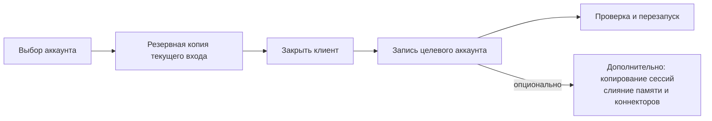

- **Сначала копия, потом запись**: файлы аутентификации, снимки входа Trae и перезапись сессий всегда оставляют точку отката.
- **Проверка после записи**: неудачная запись откатывается автоматически; при запущенном клиенте запись отклоняется, чтобы он не перезаписал ваши данные своим состоянием из памяти.
- **Удаление мягкое**: аккаунт попадает в корзину на 30 дней и может быть восстановлен; окончательное удаление уносит и учётные данные, и снимки.

## Шлюз квоты моделей

Публикует квоту текущего аккаунта локальным инструментам: совместимость с OpenAI (`/v1/models`, `/v1/chat/completions`, `/v1/responses`) и с Anthropic (`/v1/messages`), оба с SSE-потоком. По умолчанию слушается только loopback.

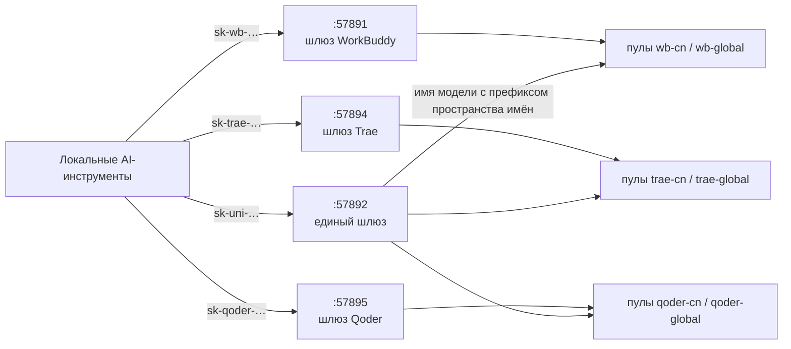

- **Четыре независимых слушателя**: порты собраны в один блок **`5789x`** — `57890` интерфейс · `57891` WorkBuddy · `57892` единый · `57893` hook сессий · `57894` Trae · `57895` Qoder. Отключение единого шлюза не влияет на существующих клиентов; маршруты `/v1/*` полностью совпадают, поэтому объединить их в один Router **нельзя**.
- **Префиксы ключей — одно семейство**: `sk-wb-` · `sk-trae-` · **`sk-qoder-`** · `sk-uni-`: по префиксу сразу видно, какой порт настраивать.
- **Три состояния ключа**: отозвать · восстановить · удалить (удалять можно только отозванные). Открытый текст возвращается один раз при создании; хранятся sha256 и первые/последние 4 символа.
- **Пул аккаунтов**: выбирает аккаунты по балансу и состоянию лимитов, исключает непригодные, проверяет лимиты «аккаунт × модель» и восстанавливает их одним кликом.

**Единый шлюз** решает проблему «одноимённые модели перекрывают друг друга между платформами»: имя модели записывается как `<пространство имён>:<id модели>`, а пространства имён выводятся из реестра областей (сейчас шесть: `wb-cn` / `wb-global` / `trae-cn` / `trae-global` / `qoder-cn` / `qoder-global`).

| Правило | Поведение |
| --- | --- |
| Имя модели без префикса | **Всегда 400** и список допустимых префиксов (никаких догадок о значении по умолчанию и тихого ухода в чужой пул) |
| Разбор пространства имён | **Только точное совпадение всего сегмента** (`trae` / `traework` / `traecode` — префиксы друг друга) |
| Один ключ на несколько платформ | Один ключ `sk-uni-` может авторизовать сразу несколько платформ |
| `/v1/responses` на `trae-*` | **501**, без тихого понижения до chat |
| Состояние по умолчанию | **Выключен**; включается в разделе «Единый шлюз» на странице шлюза |

> Архитектура: [UNIFIED-GATEWAY-ARCH.md](docs/redesign/UNIFIED-GATEWAY-ARCH.md) · Подключение клиентов: [GATEWAY-CLIENT-INTEGRATION.md](docs/GATEWAY-CLIENT-INTEGRATION.md)

## Автоматизация

Расписания поддерживают время **с точностью до минуты** (например, `09:37`), несколько времён и **случайный разброс** (±5/15/30 минут), чтобы запуски не приходились на один и тот же час.

| Сторона | Задачи |
| --- | --- |
| WorkBuddy (6) | Отметка · путешествие кота · карта активности · keepalive токена · начало учёбы · ночная сова |
| Trae (2) | Отметка · автоматическое продление JWT |

<details>
<summary><b>Политика авто-ротации (WorkBuddy, защита от сгорания кредитов)</b></summary>

Фоновая задача назначает аккаунт по умолчанию для **последующих запусков CodeBuddy CLI** — самый «срочный» (раньше истекает и ещё есть кредиты). Порядок решений:

1. Действующий аккаунт (запрос успешен, не истёк, есть остаток)
2. Срочность (если даже у самого срочного осталось больше `min_urgency_hours`, по умолчанию 72 ч → не переключать)
3. Уже выбран → не переключать
4. Кулдаун (`cooldown_minutes`, по умолчанию 120)
5. Защита активности (диалог за последние `active_guard_minutes`, по умолчанию 30 → не переключать)
6. Фильтр ценности (остаток ниже `min_remaining_credits` → переключать не стоит)
7. Антидребезг (разница меньше `min_gap_hours`, по умолчанию 24 → не переключать)

**Граница действия**: меняется только аккаунт по умолчанию для будущих сессий, текущая сессия не переключается «на ходу» — перезагрузите её через ACP или перезапустите CLI.

</details>

<details>
<summary><b>Возможности уровня приложения (общие для шести областей)</b></summary>

| Возможность | Описание |
| --- | --- |
| Настройки приложения (⚙) | Тема (светлая / тёмная / системная), язык интерфейса (简体中文 / English), тихий старт в трей, закрытие в трей, автообновление |
| Глобальные копии и восстановление | Сразу все области; выбор по аккаунтам / конфигурации / шлюзу, **по умолчанию без учётных данных** |
| Менеджер Skill | Сканирует `skills/*/SKILL.md`, включает и отключает записи (построчная перезапись, остальные байты сохраняются), переносит между регионами, импортирует из zip |
| Хостинг настроек клиента | Читает и правит `settings.json` самого upstream-клиента: таблица шести слотов, отпечаток формата, минимальный побайтовый патч, копии / восстановление / сравнение |
| Оверлей сессий (только десктоп) | Отдельное окно со статусами задач из разных источников; только чтение, клик возвращает к исходной сессии |
| Наблюдение за сессиями клиента (по умолчанию выкл.) | Ставит hook в `settings.json` WorkBuddy и передаёт статусы задач в оверлей (приёмник `127.0.0.1:57893`) |

</details>

## Данные и приватность

- Все данные лежат в `~/.buddy-switch/` на этой машине и никуда не отправляются; настройки интерфейса тоже локальны.
- Хранилища аккаунтов разделены по областям (например, `accounts.json` / `accounts.global.json`, `trae/checkin_accounts*.json`).
- В экспортируемых копиях **по умолчанию нет токенов**; открытый текст пишется только после явной галочки и повторного подтверждения, с предупреждением, что файл можно использовать для входа.
- Ключи шлюза хранят только хэш и префикс; **локальные данные не попадают в репозиторий**, а перед релизом выполняется проверка на шаблоны токенов.

## Разработка

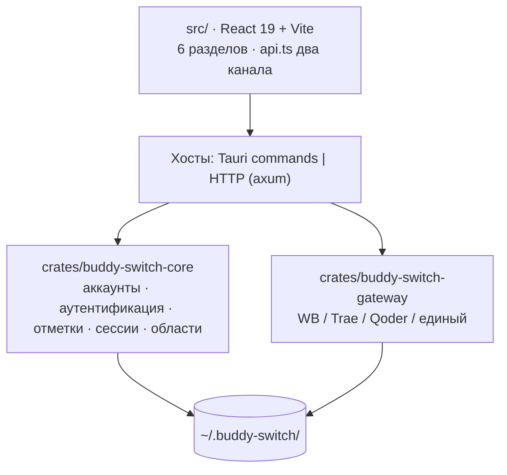

```bash
npm install
npm run tauri dev     # разработка десктопной версии
npm run build         # сборка фронтенда + проверки контракта / областей / платформ
npm run check:api     # только проверка API-контракта
```

```
crates/
  buddy-switch-core/     # аккаунты, аутентификация, OAuth, процессы, переключение, сессии, отметки, регионы, модули Trae / Qoder
  buddy-switch-gateway/  # шлюзы, совместимые с OpenAI / Anthropic (четыре реализации)
  buddy-switch-server/   # HTTP-сервер + CLI (axum API + встроенный фронтенд rust-embed)
src-tauri/               # настольный хост (тонкие обёртки Tauri + трей + хосты шлюзов)
src/                     # фронтенд: components / pages / lib / locales
npm/                     # пакеты npm (не опубликованы)
```

Требования к окружению, процесс релиза и соглашения по каталогам: [docs/DEVELOPMENT.md](docs/DEVELOPMENT.md).

## Участие в проекте

Мы рады issue, документации, исправлениям ошибок и PR с новыми возможностями. Полное руководство (что можно делать, чек-лист PR, соглашения по коду): **[CONTRIBUTING.en.md](CONTRIBUTING.en.md)** ([简体中文](CONTRIBUTING.md)).

## Поддержать проект

<table>
  <thead>
    <tr><th>WeChat Pay</th><th>Alipay</th></tr>
  </thead>
  <tbody>
    <tr>
      <td></td>
      <td></td>
    </tr>
  </tbody>
</table>

## Благодарности

- [changexbc/workbuddy-switch](https://github.com/changexbc/workbuddy-switch) — формат данных аккаунтов WorkBuddy и общий подход к переключению аккаунтов.
- [Sliverkiss/workbuddy2api](https://github.com/Sliverkiss/workbuddy2api) — идея публикации квоты моделей как OpenAI-совместимого сервиса.

Каждый проект подчиняется своей лицензии. Этот проект является независимой реализацией, не связан с ними партнёрством или одобрением; названия и товарные знаки принадлежат их правообладателям.

## Отказ от ответственности

Полный текст: **[docs/DISCLAIMER.en.md](docs/DISCLAIMER.en.md)** ([简体中文](docs/DISCLAIMER.md)), шесть разделов: неофициальный сторонний инструмент; условия обслуживания и соблюдение правил; запись данных и резервные копии; риски автоматизации; риски публикации API-шлюза; предоставление «как есть». Используя проект, вы подтверждаете, что прочитали и приняли их; если нет — прекратите использование и удалите его.

## Лицензия

**[PolyForm Noncommercial License 1.0.0](./LICENSE)**: некоммерческое использование разрешено, **коммерческое использование не лицензируется**.

- Полный текст: [LICENSE](./LICENSE)
- Простое объяснение и FAQ: [docs/LICENSING.en.md](docs/LICENSING.en.md) ([简体中文](docs/LICENSING.md))
- По вопросам коммерческой лицензии пишите через Issues этого репозитория.

## История звёзд

<a href="https://www.star-history.com/?repos=NextAgentX%2Ftrae-workbuddy-switch&type=date&legend=top-left">

 <picture>
   <source media="(prefers-color-scheme: dark)" srcset="https://api.star-history.com/chart?repos=NextAgentX/trae-workbuddy-switch&type=date&theme=dark&legend=top-left" />
   <source media="(prefers-color-scheme: light)" srcset="https://api.star-history.com/chart?repos=NextAgentX/trae-workbuddy-switch&type=date&legend=top-left" />
   
 </picture>
</a>
